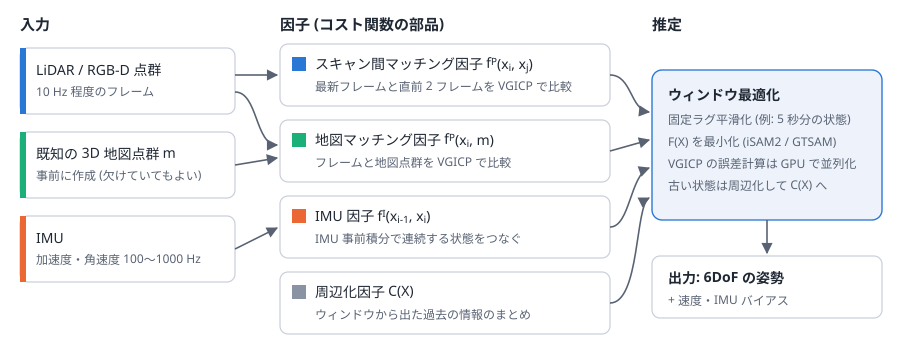
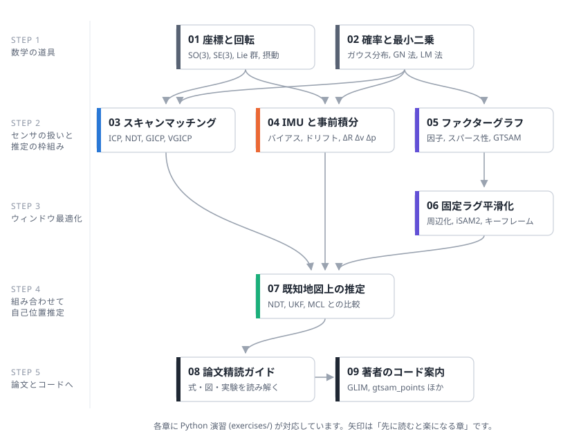

# 00. 学習ロードマップ

この教材は、次の論文を「自分の言葉で説明できる」ようになることを目標にしています。

> **点群・IMU 制約のウィンドウ最適化に基づく既知地図上での 6DoF 姿勢推定**
> 小出 健司, 大石 修士, 横塚 将志, 阪野 貴彦 (産業技術総合研究所)
> ロボティクス・メカトロニクス講演会 2023 (ROBOMECH2023)
> PDF: <https://staff.aist.go.jp/k.koide/assets/pdf/robomech2023.pdf>

## 論文をひとことで言うと

**「LiDAR の点群と IMU を使い、既知の 3D 地図の上でロボットの位置と姿勢 (6 自由度) を推定する。
その際、地図とのマッチングだけに頼らず、直前のフレーム同士のマッチングと IMU の情報も
**同じ最適化問題**に入れて、最近の数秒分の状態をまとめて最適化する」** という手法です。

こうすることで、

- 地図が一部欠けている・環境が地図作成時から変わっている場所でも、
  フレーム同士のマッチングと IMU で推定を続けられる
- 地図のある場所に戻れば、地図とのマッチングでドリフト (誤差の蓄積) が打ち消される

という性質が得られます。従来手法 (NDT マッチング、UKF ベースの hdl_localization、
パーティクルフィルタベースの mcl3d_ros) は地図とのマッチングへの依存が大きく、
地図が欠けた領域に入ると推定が破綻した、と報告されています。



## 論文の目的関数

論文の中心は次のコスト関数です。これを最小にする状態 $X$ を求めます。

```math
F(\mathcal{X}) = \sum_{\mathbf{x}_i \in \mathcal{X}} \sum_{j=i-2}^{i-1} f^{P}(\mathbf{x}_i, \mathbf{x}_j)
 + \sum_{\mathbf{x}_i \in \mathcal{X}} f^{P}(\mathbf{x}_i, \mathcal{M})
 + \sum_{\mathbf{x}_i \in \mathcal{X}} f^{I}(\mathbf{x}_{i-1}, \mathbf{x}_i)
 + C(\mathcal{X})
```

| 記号 | 意味 | 詳しくは |
| --- | --- | --- |
| X | 最適化ウィンドウ内の状態 (例: 最新 5 秒分) | [06 章](06_fixed_lag_smoothing.md) |
| x_i | 時刻 i のセンサ状態 (姿勢・速度・IMU バイアス) | [01 章](01_coordinates_and_rotation.md), [04 章](04_imu_and_preintegration.md) |
| f^P(x_i, x_j) | フレーム i と j の点群マッチングのコスト (VGICP) | [03 章](03_point_cloud_registration.md) |
| f^P(x_i, M) | フレーム i と地図点群 M のマッチングのコスト | [03 章](03_point_cloud_registration.md), [07 章](07_map_based_localization.md) |
| f^I(x_{i-1}, x_i) | IMU 事前積分による運動の整合性のコスト | [04 章](04_imu_and_preintegration.md) |
| C(X) | ウィンドウから外れた過去の情報 (周辺化因子) | [06 章](06_fixed_lag_smoothing.md) |

この式の 1 項 1 項が「なぜそういう形なのか」「どうやって計算するのか」を理解するのが、この教材のゴールです。

## 必要な知識の地図



| 章 | 内容 | 演習 | 目安 |
| --- | --- | --- | --- |
| [01 座標と回転](01_coordinates_and_rotation.md) | 回転行列、SO(3)/SE(3)、Lie 群、摂動によるヤコビアン | ex01 | 2〜3 時間 |
| [02 確率と最小二乗](02_probability_and_least_squares.md) | 誤差ベクトル、正規分布と共分散行列、最尤推定、ガウス・ニュートン法 | ex02a, ex02b | 3 時間 |
| [03 スキャンマッチング](03_point_cloud_registration.md) | ICP、NDT、GICP、VGICP、GPU 化 | ex03a, ex03b, ex04 | 3〜4 時間 |
| [04 IMU と事前積分](04_imu_and_preintegration.md) | IMU の観測モデル、バイアス、ドリフト、事前積分 | ex05 | 3 時間 |
| [05 ファクターグラフ](05_factor_graph.md) | 因子・変数、スパース性、GTSAM、iSAM2 | ex06 | 2 時間 |
| [06 固定ラグ平滑化と周辺化](06_fixed_lag_smoothing.md) | ウィンドウ最適化、シューア補行列、キーフレーム | ex06, ex07 | 2〜3 時間 |
| [07 既知地図上の自己位置推定](07_map_based_localization.md) | NDT・UKF・MCL と提案手法の違い | ex07 | 1〜2 時間 |
| [08 論文精読ガイド](08_paper_walkthrough.md) | 論文を節ごとに読み解く。2D 再現実験 | ex07 | 2 時間 |
| [09 著者のコード案内](09_author_code_guide.md) | GLIM, gtsam_points, small_gicp などのどこに何があるか | optional | 適宜 |
| [10 用語集](10_glossary.md) | 日本語・英語の対応表 | - | - |

## おすすめの進め方

1. **まず論文を 1 回ざっと読む。** 分からない単語に印をつけるだけで OK です。
2. **01 → 07 章を順に読み、各章の演習を実行する。** 数式は「何を表しているか」を優先し、
   導出は演習のコードで数値的に確かめるくらいで十分です。
3. **08 章を見ながら論文をもう一度読む。** 1 回目に印をつけた単語がすべて説明できるかチェックします。
4. **余裕があれば 09 章を見ながら著者のコード (GLIM) を読む。** 論文の式がコードのどこに対応するかを追うと、
   理解が一段深まります。

各章の最後にある「理解度チェック」で、説明できるか確認しながら進めてください。

## 学習を始める前の準備

リポジトリのトップの [README](../README.md) に従って Python 環境を作り、次を実行してください。

```bash
python exercises/check_env.py
```

すべての演習は numpy / scipy / matplotlib だけで動きます。ROS や GPU は不要です。

## 理解度チェック (最終目標)

この教材を終えたとき、次の質問に答えられるようになっているはずです。

1. なぜ地図マッチングだけでなく、前後フレームのマッチングもコスト関数に入れるのか?
2. IMU 事前積分を使うと、何が効率的になるのか?
3. VGICP が GPU と相性が良いのはなぜか?
4. ウィンドウから外れた状態をただ捨てずに「周辺化」するのはなぜか?
5. フィルタ (UKF・パーティクルフィルタ) とウィンドウ最適化の違いは何か?
6. 提案手法が苦手そうな状況はどんなときか?

---

次へ: [01 座標と回転](01_coordinates_and_rotation.md)
