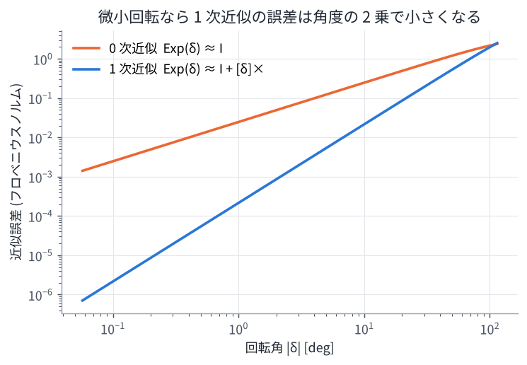
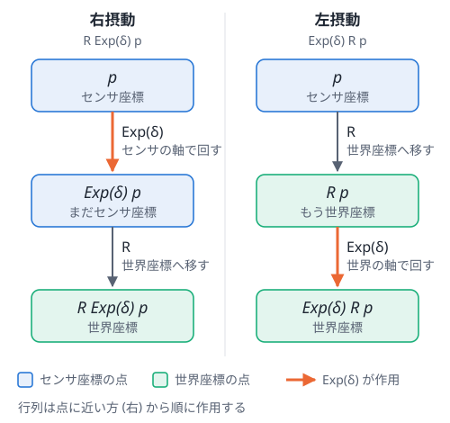

# 01. 座標と回転 (SO(3), SE(3), Lie 群)

## この章のゴール

- センサの「姿勢 (pose)」を回転行列と並進ベクトルで表し、点の座標変換ができる
- 相対姿勢 $\mathbf{T}_i^{-1}\mathbf{T}_j$ の意味が分かる
- 回転は普通のベクトルのように足し算できないこと、そのために Lie 群の道具 (Exp / Log) を使うことが分かる
- 「微小回転を掛ける」ことでヤコビアンを求める方法 (摂動) が分かる

> **論文とのつながり**
> 論文の状態 $\mathbf{x}_i$ には 6 自由度の姿勢が含まれます。スキャンマッチング因子 $f^P(\mathbf{x}_i, \mathbf{x}_j)$ は
> 「フレーム j の点群を、相対姿勢でフレーム i の座標に移して比べる」ものですし、
> 最適化 (ガウス・ニュートン法) では姿勢に「微小な更新量」を足していく必要があります。
> この章の内容はすべての因子の土台です。

---

## 1. 姿勢 = 位置 + 向き

3 次元空間の剛体の姿勢は、**位置 3 自由度 + 向き 3 自由度 = 6 自由度 (6DoF)** で表せます。
論文タイトルの「6DoF 姿勢推定」はこれのことです。

- 位置: 並進ベクトル $\mathbf{t} \in \mathbb{R}^3$
- 向き: 回転行列 $\mathbf{R} \in SO(3)$

回転行列は $3 \times 3$ の行列ですが、次の条件を満たすものだけが「回転」です。

```math
\mathbf{R}^\top \mathbf{R} = \mathbf{I}, \qquad \det(\mathbf{R}) = 1
```

この条件を満たす行列全体を **SO(3)** (3 次元の特殊直交群) と呼びます。
9 個の数字を持っていますが、条件のせいで自由に動かせるのは 3 自由度だけです。

## 2. 座標変換と同次変換行列

センサ (LiDAR) が観測した点 $\mathbf{p}$ はセンサの座標系で表されています。
センサの姿勢が $(\mathbf{R}, \mathbf{t})$ のとき、その点の世界座標は

```math
\mathbf{p}^{\text{world}} = \mathbf{R}\,\mathbf{p}^{\text{sensor}} + \mathbf{t}
```

です。これを 4×4 の **同次変換行列** でまとめると、掛け算 1 回で書けて便利です。

```math
\mathbf{T} = \begin{bmatrix} \mathbf{R} & \mathbf{t} \\ \mathbf{0}^\top & 1 \end{bmatrix} \in SE(3),
\qquad
\begin{bmatrix} \mathbf{p}^{\text{world}} \\ 1 \end{bmatrix} = \mathbf{T} \begin{bmatrix} \mathbf{p}^{\text{sensor}} \\ 1 \end{bmatrix}
```

このような行列全体を **SE(3)** (3 次元の特殊ユークリッド群) と呼びます。

### 合成と逆変換

- 合成: 変換を続けて行うのは行列の掛け算 $\mathbf{T}_a \mathbf{T}_b$
- 逆変換: 回転行列の逆は転置で済むので、次のように簡単に計算できる

```math
\mathbf{T}^{-1} = \begin{bmatrix} \mathbf{R}^\top & -\mathbf{R}^\top \mathbf{t} \\ \mathbf{0}^\top & 1 \end{bmatrix}
```

### 名前の付け方のコツ: `T_world_sensor`

著者のコード (GLIM など) では `T_world_imu` のような変数名がよく出てきます。
これは「imu 座標系の点を world 座標系に移す変換」という意味です。
添字を「左 ← 右」と読むと、合成が正しいかを目で確認できます。

```math
\mathbf{T}_{\text{world}\leftarrow\text{lidar}} = \mathbf{T}_{\text{world}\leftarrow\text{imu}}\;\mathbf{T}_{\text{imu}\leftarrow\text{lidar}}
```

(内側の添字 imu が打ち消し合っている)

### 相対姿勢

世界座標での姿勢 $\mathbf{T}_i, \mathbf{T}_j$ から、**フレーム j の座標をフレーム i の座標に移す変換** は

```math
\mathbf{T}_{ij} = \mathbf{T}_i^{-1}\,\mathbf{T}_j
```

です。論文のスキャン間マッチング因子は、まさにこの $\mathbf{T}_{ij}$ でフレーム j の点をフレーム i に移して
比べています ([03 章](03_point_cloud_registration.md))。

## 3. 回転の表し方いろいろ

| 表現 | 数字の個数 | 長所 | 短所 |
| --- | --- | --- | --- |
| 回転行列 | 9 | 合成・点の変換が掛け算で簡単 | 冗長。誤差が溜まると直交性が崩れる |
| オイラー角 (roll, pitch, yaw) | 3 | 人間に分かりやすい | ジンバルロック (特異点) がある。合成が面倒 |
| 四元数 (クォータニオン) | 4 | コンパクトで特異点なし。数値的に安定 | 直感的でない。q と -q が同じ回転 |
| 回転ベクトル (軸 × 角度) | 3 | 最小の 3 個。微小回転の表現に最適 | 合成は直接できない (Exp/Log を経由) |

最適化では「**姿勢そのものは回転行列 (や四元数) で持ち、更新量は回転ベクトルで表す**」のが定番です。
GTSAM もこの方式です。

## 4. 回転は足し算できない → Lie 群の考え方

ガウス・ニュートン法では「今の推定値 + 更新量」を繰り返します。
しかし回転行列に普通に行列を足すと、$\mathbf{R}^\top\mathbf{R} = \mathbf{I}$ が崩れて回転行列でなくなってしまいます。

そこで、

1. 更新量は 3 次元の **回転ベクトル** $\boldsymbol{\delta} \in \mathbb{R}^3$ で表す (これは自由に足し引きできる)
2. それを **指数写像 Exp** で回転行列に直す
3. 掛け算で今の回転に合成する

という手順を踏みます。

```math
\mathbf{R} \leftarrow \mathbf{R}\,\operatorname{Exp}(\boldsymbol{\delta})
```

### hat 演算子と指数写像

回転ベクトル $\boldsymbol{\omega} = (\omega_x, \omega_y, \omega_z)$ から作る歪対称行列を $[\boldsymbol{\omega}]_\times$ と書きます (hat 演算子)。

```math
[\boldsymbol{\omega}]_\times = \begin{bmatrix} 0 & -\omega_z & \omega_y \\ \omega_z & 0 & -\omega_x \\ -\omega_y & \omega_x & 0 \end{bmatrix},
\qquad [\boldsymbol{\omega}]_\times \mathbf{p} = \boldsymbol{\omega} \times \mathbf{p}
```

指数写像は、回転角 $\theta = \lVert\boldsymbol{\omega}\rVert$、回転軸 $\mathbf{a} = \boldsymbol{\omega}/\theta$ として
**ロドリゲスの公式** で計算できます。

```math
\operatorname{Exp}(\boldsymbol{\omega}) = \mathbf{I} + \sin\theta\,[\mathbf{a}]_\times + (1 - \cos\theta)\,[\mathbf{a}]_\times^2
```

逆向きの **対数写像 Log** は回転行列から回転ベクトルを取り出します。

イメージとしては、SO(3) は「曲がった空間 (多様体)」で、その 1 点に接する平らな空間 (接空間, 3 次元) の上で
計算してから Exp で曲がった空間に戻している、という感じです。

### 微小回転の近似

$\boldsymbol{\delta}$ が小さいときは

```math
\operatorname{Exp}(\boldsymbol{\delta}) \approx \mathbf{I} + [\boldsymbol{\delta}]_\times
```

と近似できます。演習 1 の図で、この近似の誤差が角度の 2 乗で小さくなることを確かめられます。



## 5. 摂動 (perturbation) でヤコビアンを求める

最適化には「状態を少し動かしたとき、誤差がどれだけ変わるか (ヤコビアン)」が必要です。
回転を少し動かすことを「$\mathbf{R}$ に右から $\operatorname{Exp}(\boldsymbol{\delta})$ を掛ける」と定義すると、
計算がとても簡単になります。

例として、点を回転させる関数 $f(\mathbf{R}) = \mathbf{R}\mathbf{p}$ を考えます。

```math
\mathbf{R}\operatorname{Exp}(\boldsymbol{\delta})\,\mathbf{p}
\approx \mathbf{R}(\mathbf{I} + [\boldsymbol{\delta}]_\times)\mathbf{p}
= \mathbf{R}\mathbf{p} + \mathbf{R}(\boldsymbol{\delta}\times\mathbf{p})
= \mathbf{R}\mathbf{p} - \mathbf{R}[\mathbf{p}]_\times\boldsymbol{\delta}
```

したがって

```math
\frac{\partial (\mathbf{R}\mathbf{p})}{\partial \boldsymbol{\delta}} = -\mathbf{R}\,[\mathbf{p}]_\times
```

です。最後の変形では外積の性質 $\boldsymbol{\delta}\times\mathbf{p} = -\mathbf{p}\times\boldsymbol{\delta}$ を使いました。

GLIM の論文 (RAS 2024) に出てくる VGICP 因子のヤコビアン
$\mathbf{A}_k = [\,\mathbf{R}_{ij}[\boldsymbol{\mu}_k]_\times,\ -\mathbf{R}_{ij}\,]$ なども、この計算の応用です
(符号は誤差の定義の向きで変わります)。

### 右摂動と左摂動: δ はどの座標系の回転か

ここまでは「$\mathbf{R}$ に **右から** $\operatorname{Exp}(\boldsymbol{\delta})$ を掛ける」と決めて計算しました。
実は **左から** 掛ける流儀もあり、文献によってどちらも使われます。

```math
\text{右摂動: } \mathbf{R}' = \mathbf{R}\operatorname{Exp}(\boldsymbol{\delta})
```

```math
\text{左摂動: } \mathbf{R}' = \operatorname{Exp}(\boldsymbol{\delta})\,\mathbf{R}
```

どちらも「$\mathbf{R}$ の近くの回転」を表せますが、**同じ $\boldsymbol{\delta}$ でも意味する回転が違います**。

- 右摂動の $\boldsymbol{\delta}$ は、**センサ座標系の軸** (センサの前・左・上) まわりの回転
- 左摂動の $\boldsymbol{\delta}$ は、**世界座標系の軸** (地図の x・y・z) まわりの回転

なぜそうなるのかを、3 つの見方で説明します。
前提として、この章の $\mathbf{R}$ は「センサ座標の点を世界座標に移す回転」($\mathbf{R}_{\text{world}\leftarrow\text{sensor}}$) です。

#### 理由 1: 点に掛ける順番を追う

回転を点 $\mathbf{p}$ (センサ座標) に作用させると、行列は **点に近い方、つまり右から順に** 作用します。
大事なのは、$\operatorname{Exp}(\boldsymbol{\delta})$ が作用する瞬間に、点がどの座標系で表されているかです。

```math
\text{右摂動: }\ \mathbf{R}\operatorname{Exp}(\boldsymbol{\delta})\,\mathbf{p}
= \mathbf{R}\,\underbrace{\bigl(\operatorname{Exp}(\boldsymbol{\delta})\,\mathbf{p}\bigr)}_{\text{センサ座標のまま回す}}
```

```math
\text{左摂動: }\ \operatorname{Exp}(\boldsymbol{\delta})\,\mathbf{R}\,\mathbf{p}
= \operatorname{Exp}(\boldsymbol{\delta})\,\underbrace{\bigl(\mathbf{R}\,\mathbf{p}\bigr)}_{\text{もう世界座標}}
```



- **右摂動**: $\operatorname{Exp}(\boldsymbol{\delta})$ が作用するとき、点はまだセンサ座標で表されています。
  センサ座標の中で「x 軸まわりに回す」と言えば、それはセンサの x 軸 (例えばロボットの前方向) まわりです。
  回し終わってから $\mathbf{R}$ で世界に移すので、$\boldsymbol{\delta}$ の軸はセンサの軸になります。
- **左摂動**: 先に $\mathbf{R}$ で世界座標に移してから $\operatorname{Exp}(\boldsymbol{\delta})$ が作用します。
  世界座標の中で「x 軸まわりに回す」と言えば、それは地図の x 軸まわりです。

行列 $\operatorname{Exp}(\boldsymbol{\delta})$ そのものは同じでも、**作用する相手 (点) がどちらの座標系で書かれているか** で、軸の意味が変わるのです。

#### 理由 2: 添字のルールで確かめる

2 節の「添字を左 ← 右と読む」ルールでも確かめられます。$\mathbf{R} = \mathbf{R}_{\text{w}\leftarrow\text{s}}$ (w = 世界, s = センサ) です。

- 右摂動 $\mathbf{R}_{\text{w}\leftarrow\text{s}}\operatorname{Exp}(\boldsymbol{\delta})$:
  $\operatorname{Exp}(\boldsymbol{\delta})$ は右隣の添字 s とつながる必要があるので、「s の座標 → s の座標」の変換です。
  入力も出力もセンサ座標なので、これは **センサ座標系の中での回転** です。
- 左摂動 $\operatorname{Exp}(\boldsymbol{\delta})\,\mathbf{R}_{\text{w}\leftarrow\text{s}}$:
  $\operatorname{Exp}(\boldsymbol{\delta})$ は左隣の添字 w の後に来るので、「w の座標 → w の座標」の変換、
  つまり **世界座標系の中での回転** です。

#### 理由 3: 具体例で、同じ δ が別の動きになるのを見る

ロボットが地図の上で **左に 90° 向いている** (yaw = 90°) とします。センサ座標は x = 前、y = 左、z = 上 です。

```math
\mathbf{R} = \begin{bmatrix} 0 & -1 & 0 \\ 1 & 0 & 0 \\ 0 & 0 & 1 \end{bmatrix}
```

$\mathbf{R}$ の各列は、センサの x, y, z 軸を世界座標で表したものです。したがって

- センサの前 (x 軸) は、世界の +y 方向を向いている (1 列目 = (0, 1, 0))
- センサの左 (y 軸) は、世界の −x 方向を向いている (2 列目 = (−1, 0, 0))

ここに $\boldsymbol{\delta} = (0.1,\ 0,\ 0)$ (「x 軸まわりに 0.1 rad」) を加えます。

| | 右摂動 R Exp(δ) | 左摂動 Exp(δ) R |
| --- | --- | --- |
| 軸 | センサの x 軸 = ロボットの前 | 世界の x 軸 = ロボットの右 |
| 動き | **ロール** (左側が持ち上がる) | **ピッチ** (機首が上がる) |
| 前方向 | (0, 1, 0) のまま | (0, 0.995, **0.100**) |
| 左方向 | (−0.995, 0, **0.100**) | (−1, 0, 0) のまま |

(前方向・左方向は回転後の向きを世界座標で表したもの。z 成分が正なら上を向いたということ)

同じ $\boldsymbol{\delta}$ なのに、右摂動ではロール、左摂動ではピッチになります。
ロボットがたまたま世界の x 軸方向を向いていれば (yaw = 0°) 両者は一致しますが、
向きが変わると一致しなくなります。演習 1 の 7 節で、この表の数値を計算して確かめられます。

#### 2 つの関係: 回転軸を座標変換するだけ

右摂動の $\boldsymbol{\delta}_{\text{s}}$ (センサ座標) と左摂動の $\boldsymbol{\delta}_{\text{w}}$ (世界座標) が同じ回転を表す、つまり

```math
\mathbf{R}\operatorname{Exp}(\boldsymbol{\delta}_{\text{s}}) = \operatorname{Exp}(\boldsymbol{\delta}_{\text{w}})\,\mathbf{R}
```

となるのは、次の関係のときです。

```math
\boldsymbol{\delta}_{\text{w}} = \mathbf{R}\,\boldsymbol{\delta}_{\text{s}}
```

上の具体例なら、$\boldsymbol{\delta}_{\text{s}} = (0.1, 0, 0)$ (センサの前方向の軸) は $\boldsymbol{\delta}_{\text{w}} = \mathbf{R}\boldsymbol{\delta}_{\text{s}} = (0, 0.1, 0)$ (世界の y 軸) に対応します。

回転ベクトルは「回転軸の向き × 角度」なので、センサ座標で書いた回転軸を $\mathbf{R}$ で世界座標に書き直せば、
世界座標で書いた回転軸になる、というだけのことです。
(式としては $\mathbf{R}[\boldsymbol{\delta}]_\times\mathbf{R}^\top = [\mathbf{R}\boldsymbol{\delta}]_\times$ から導けます。
SE(3) では随伴行列 $\mathrm{Ad}_{\mathbf{T}}$ が同じ役割をします)

#### どちらを使うと何が変わるのか

最適化が収束すれば、どちらの流儀でも同じ姿勢が得られます。変わるのは $\boldsymbol{\delta}$ と、それに関係する量の **表し方** です。

- **ヤコビアンの形**: $\partial(\mathbf{R}\mathbf{p})/\partial\boldsymbol{\delta}$ は、右摂動なら $-\mathbf{R}[\mathbf{p}]_\times$、左摂動なら $-[\mathbf{R}\mathbf{p}]_\times$ です。
  論文の式をコードに写すとき、流儀を混ぜると形や符号が合わなくなります。
- **共分散の意味**: 推定の不確かさ (共分散) も $\boldsymbol{\delta}$ の座標系で表されます。
  GTSAM は右摂動なので、`Pose3` の共分散は **センサ (ボディ) 座標系** で書かれています。
  共分散の「x 方向の分散」は地図の x 方向ではなく、ロボットの前方向の分散です。
  地図の座標で見たいときは、回転部分なら $\mathbf{R}\boldsymbol{\Sigma}\mathbf{R}^\top$ のように変換します。
- **IMU との相性**: ジャイロはセンサ座標の角速度 $\boldsymbol{\omega}$ を測るので、姿勢の積分は
  $\mathbf{R}_{k+1} = \mathbf{R}_k\operatorname{Exp}(\boldsymbol{\omega}\Delta t)$ と **右から** 掛ける形になります ([04 章](04_imu_and_preintegration.md))。
  右摂動を使えば、IMU の計測と推定の誤差を同じセンサ座標系で扱えます。GTSAM や多くの LiDAR・IMU の手法が右摂動を使う理由の 1 つです。

論文やコードを読むときは、まず「更新が $\mathbf{R}\operatorname{Exp}(\boldsymbol{\delta})$ か $\operatorname{Exp}(\boldsymbol{\delta})\mathbf{R}$ か」を確認しましょう。
それが分かれば、ヤコビアンや共分散がどの座標系で書かれているかも分かります。

## 6. SE(3) の場合

姿勢全体 $\mathbf{T}$ も同じように、6 次元の更新量 $\boldsymbol{\xi} = (\boldsymbol{\delta}_\text{rot}, \boldsymbol{\delta}_\text{trans})$ を使って
$\mathbf{T} \leftarrow \mathbf{T}\operatorname{Exp}(\boldsymbol{\xi})$ と更新します。
GTSAM の `Pose3` は回転 3 成分 → 並進 3 成分の順に並べます (ライブラリによって順番が違うので注意)。

## 7. 演習で使う 2D 版: SE(2)

演習では計算を簡単にするため、2D の姿勢 $(x, y, \theta)$ を使います。

```math
\mathbf{R}(\theta) = \begin{bmatrix} \cos\theta & -\sin\theta \\ \sin\theta & \cos\theta \end{bmatrix},
\qquad \mathbf{p}^{\text{world}} = \mathbf{R}(\theta)\mathbf{p} + \begin{bmatrix} x \\ y \end{bmatrix}
```

2D の回転は角度 1 個で表せて、角度は (範囲を $[-\pi, \pi)$ に丸めれば) 足し算できます。
3D の考え方を 2D で練習してから 3D に戻ると理解しやすくなります。

## 演習 1

```bash
python exercises/ex01_rotation.py
```

- 回転行列の性質、Exp と Log が逆であることを確認
- 回転の合成の順番を入れ替えると結果が変わることを確認
- 解析的に求めたヤコビアン $-\mathbf{R}[\mathbf{p}]_\times$ と数値微分が一致することを確認
- 相対姿勢 $\mathbf{T}_i^{-1}\mathbf{T}_j$ で点を変換
- 右摂動と左摂動で、同じ $\boldsymbol{\delta}$ がロールとピッチという別の動きになることを確認

## 理解度チェック

1. 回転行列が 9 個の数字を持つのに、自由度が 3 なのはなぜ?
2. $\mathbf{T}_i$, $\mathbf{T}_j$ が世界座標での姿勢のとき、フレーム j で観測した点をフレーム i の座標に移す変換は?
3. 最適化の更新で $\mathbf{R} + \Delta\mathbf{R}$ としてはいけないのはなぜ? 代わりにどうする?
4. $\dfrac{\partial(\mathbf{R}\operatorname{Exp}(\boldsymbol{\delta})\mathbf{p})}{\partial\boldsymbol{\delta}}$ を導出せよ。
5. 右摂動 $\mathbf{R}\operatorname{Exp}(\boldsymbol{\delta})$ の $\boldsymbol{\delta}$ がセンサ座標系の回転になるのはなぜ?

<details markdown="1">
<summary>答えの例</summary>

1. $\mathbf{R}^\top\mathbf{R} = \mathbf{I}$ (6 個の独立な条件) があるので、9 − 6 = 3 自由度。
2. $\mathbf{T}_{ij} = \mathbf{T}_i^{-1}\mathbf{T}_j$。
3. 足し算すると直交性が崩れて回転行列でなくなる。回転ベクトル $\boldsymbol{\delta}$ で更新量を表し、$\mathbf{R}\operatorname{Exp}(\boldsymbol{\delta})$ と掛け算で更新する。
4. $\operatorname{Exp}(\boldsymbol{\delta}) \approx \mathbf{I} + [\boldsymbol{\delta}]_\times$ を使って $-\mathbf{R}[\mathbf{p}]_\times$。
5. 点 $\mathbf{p}$ に作用させると $\mathbf{R}(\operatorname{Exp}(\boldsymbol{\delta})\mathbf{p})$ となり、$\operatorname{Exp}(\boldsymbol{\delta})$ は $\mathbf{R}$ で世界座標に移す **前の**、センサ座標で表された点を回すから。左摂動では世界座標に移した **後の** 点を回すので、世界座標系の回転になる。

</details>

## もっと知りたい人へ

- J. Solà, J. Deray, D. Atchuthan, "A micro Lie theory for state estimation in robotics," arXiv:1812.01537, 2018.
  (Lie 群を「使う側」の視点で短くまとめた定番資料)
- T. D. Barfoot, *State Estimation for Robotics*, Cambridge University Press. (無料 PDF あり)

---

前へ: [00 学習ロードマップ](00_roadmap.md) ｜ 次へ: [02 確率と最小二乗](02_probability_and_least_squares.md)
