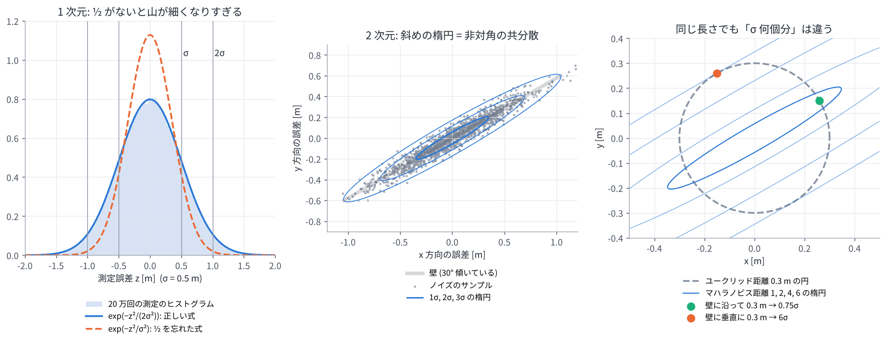
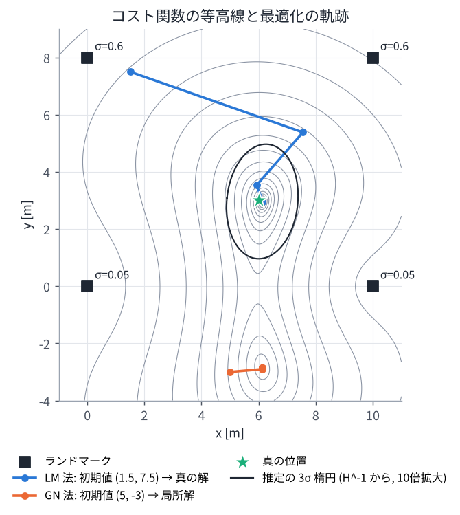

# 02. 確率と最小二乗 (誤差ベクトル・正規分布・ガウス・ニュートン法)

## この章のゴール

- **誤差ベクトル** (残差) とは何かを、具体的な数値で説明できる
- 1 次元の正規分布の式の各部分、特に **−1/2** がなぜ付いているかが分かる
- ノイズが多次元になると、なぜ **共分散行列** が必要になるのかが分かる
- マハラノビス距離と「情報行列 = 共分散の逆行列」の意味が分かる
- 「もっともらしい状態を探す」ことが「重み付き最小二乗問題を解く」ことになる理由を、式を追って説明できる
- ガウス・ニュートン法の 1 ステップを手で計算できる
- 推定の不確かさが $\mathbf{H}^{-1}$ で表せる理由が分かる

> **論文とのつながり**
> 論文のコスト関数 $F(\mathcal{X})$ は、すべての因子の「誤差ベクトルを共分散で重み付けした 2 乗」の和です。
> これを最小にする状態を、GTSAM (iSAM2) がガウス・ニュートン法の仲間を使って求めています。
> GICP が使う「分布同士の距離」も、この章で出てくるマハラノビス距離そのものです。
> この章は、論文に出てくるほぼすべての式の土台になります。

---

## 0. この章で使う記号

この章では、ベクトルと行列の計算を少しだけ使います。必要なのは次の 3 つだけです。

**ベクトル** は数字を縦に並べたもので、太字の小文字で書きます。

```math
\mathbf{e} = \begin{bmatrix} e_1 \\ e_2 \end{bmatrix}
```

**転置** $\mathbf{e}^\top$ は、縦に並んだものを横に並べ直したものです。
横ベクトルと縦ベクトルを掛けると、成分ごとの積の和 (1 つの数) になります。

```math
\mathbf{e}^\top \mathbf{e} = \begin{bmatrix} e_1 & e_2 \end{bmatrix} \begin{bmatrix} e_1 \\ e_2 \end{bmatrix} = e_1^2 + e_2^2
```

これはベクトルの長さの 2 乗 $\lVert\mathbf{e}\rVert^2$ です。

**2 次形式** $\mathbf{e}^\top \mathbf{A}\, \mathbf{e}$ は、間に行列を挟んだものです。2×2 の場合を書き下すと

```math
\begin{aligned}
\mathbf{e}^\top \mathbf{A}\, \mathbf{e}
&= \begin{bmatrix} e_1 & e_2 \end{bmatrix}
\begin{bmatrix} a & b \\ b & c \end{bmatrix}
\begin{bmatrix} e_1 \\ e_2 \end{bmatrix} \\
&= a\, e_1^2 + 2b\, e_1 e_2 + c\, e_2^2
\end{aligned}
```

となります。$\mathbf{A}$ が単位行列なら $e_1^2 + e_2^2$ (長さの 2 乗) に戻ります。
**「各成分の 2 乗に重みを付けて足し、さらに成分どうしの掛け算の項も足したもの」** と思ってください。
この章の式のほとんどはこの形です。

**逆行列** $\mathbf{A}^{-1}$ は、$\mathbf{A}\mathbf{A}^{-1} = \mathbf{I}$ (単位行列) となる行列です。
対角行列なら、対角成分をそれぞれ逆数にするだけです。

```math
\begin{bmatrix} a & 0 \\ 0 & c \end{bmatrix}^{-1} = \begin{bmatrix} 1/a & 0 \\ 0 & 1/c \end{bmatrix}
```

---

## 1. 誤差ベクトルとは

### 1.1 予測した観測と、実際の観測のずれ

例として、2 次元平面上のロボットが、位置の分かっている 2 つのランドマークまでの距離を測ったとします。

- ランドマーク 1: $(0, 0)$、ランドマーク 2: $(6, 0)$
- 実際に測った距離: $\mathbf{z} = (3.30,\ 3.05)$ [m]

ロボットの位置 $\mathbf{x}$ は分かりません。仮に「$\mathbf{x} = (3, 1)$ にいるのでは?」と考えてみます。
そこからランドマークまでの距離を計算すると、

```math
\begin{aligned}
h_1(\mathbf{x}) &= \sqrt{3^2 + 1^2} = 3.162 \\
h_2(\mathbf{x}) &= \sqrt{(3-6)^2 + 1^2} = 3.162
\end{aligned}
```

です。これは「もし $\mathbf{x}$ にいたら、こう観測されるはず」という **予測した観測** です。
予測と実際の観測の差を、成分ごとに縦に並べたものが **誤差ベクトル** (残差ベクトル, residual) です。

```math
\begin{aligned}
\mathbf{e}(\mathbf{x}) &= \mathbf{h}(\mathbf{x}) - \mathbf{z} \\
&= \begin{bmatrix} 3.162 - 3.30 \\ 3.162 - 3.05 \end{bmatrix}
= \begin{bmatrix} -0.138 \\ +0.112 \end{bmatrix}
\end{aligned}
```

- 1 成分目が負: 予測の方が短い。実際にはランドマーク 1 が予測より遠くに見えている
- 2 成分目が正: 予測の方が長い。実際にはランドマーク 2 が予測より近くに見えている

つまり、本当のロボットはもう少しランドマーク 2 寄り (右) にいそうだ、と分かります。
$\mathbf{x}$ を動かすと $\mathbf{e}(\mathbf{x})$ が変わります。**$\mathbf{e}$ が全体として 0 に近くなる $\mathbf{x}$ を探す** のが、この章の最小二乗法です。

### 1.2 なぜ「ベクトル」なのか

観測される数字が複数あるので、ずれも複数の数字になります。それを 1 つにまとめて扱うためにベクトルにします。
誤差ベクトルの次元は「観測した数字の個数」です。

| 観測 | 誤差ベクトルの中身 | 次元 |
| --- | --- | --- |
| 2 つのランドマークまでの距離 (上の例) | 距離 1 のずれ、距離 2 のずれ | 2 |
| LiDAR の 1 点と、対応する地図の点 (VGICP) | x, y, z 方向の位置のずれ | 3 |
| IMU 事前積分 (04 章) | 回転のずれ 3、速度のずれ 3、位置のずれ 3 | 9 |

符号の向き ($\mathbf{h} - \mathbf{z}$ か $\mathbf{z} - \mathbf{h}$ か) は文献によって違いますが、最後に 2 乗するのでどちらでも結果は同じです。

### 1.3 ノイズと残差の違い

ここで 2 つの言葉を区別しておきます。

- **ノイズ**: センサの測定に乗る本当の誤差。$\mathbf{z} = \mathbf{h}(\mathbf{x}_{\text{真}}) + \text{ノイズ}$。真の位置を知らないので、ノイズの値も分からない
- **残差** (誤差ベクトル): 仮の推定値 $\mathbf{x}$ を使って計算したずれ $\mathbf{e}(\mathbf{x}) = \mathbf{h}(\mathbf{x}) - \mathbf{z}$。いつでも計算できる

もし $\mathbf{x}$ がちょうど真の位置なら、残差はノイズ (の符号を反転したもの) にぴったり一致します。
したがって、良い推定値 $\mathbf{x}$ とは **「残差が、ノイズとしてありそうな値になっている $\mathbf{x}$」** のことです。
「ノイズとしてありそう」を数式で表すために、次の節で確率分布を使います。

---

## 2. 1 次元の正規分布

### 2.1 測定を繰り返すと釣り鐘型になる

同じ距離を何度も測ると、値は毎回少しずつばらつきます。ばらつきのヒストグラムを描くと、多くのセンサで
真ん中が高く、両側になだらかに下がる **釣り鐘型** になります (下の図の左。この図は 3, 4 節でも使います)。
これを表すのが **正規分布** (ガウス分布) です。

```math
p(z) = \frac{1}{\sqrt{2\pi\sigma^2}}\, \exp\!\left( -\frac{1}{2}\, \frac{(z - \mu)^2}{\sigma^2} \right)
```

$\mu$ は平均 (真ん中の位置)、$\sigma$ は **標準偏差** (ばらつきの大きさ) です。$\sigma^2$ を **分散** と呼びます。



### 2.2 式の各部分の意味

内側から順に読みます。

| 部分 | 意味 |
| --- | --- |
| z − μ | 平均からのずれ |
| (z − μ) / σ | ずれが σ 何個分か。σ = 0.5 m で 1 m ずれていれば「2 個分」 |
| 2 乗 | プラス側とマイナス側のずれを同じに扱う。遠いほど急に大きくなる |
| −1/2 を掛ける | 次の 2.3 で説明 |
| exp | 0 より大きい値にする。ずれが 0 のとき exp(0) = 1 で最大 |
| 1 / √(2πσ²) | 曲線の下の面積 (全確率) をちょうど 1 にするための定数 |

最後の定数は $z$ に関係しないので、この後の「一番もっともらしい値を探す」計算では消えてしまいます。
大事なのは $\exp$ の中身です。

### 2.3 −1/2 はどこから来るのか

**マイナスの理由** は簡単です。$\exp(+\text{正の数})$ だと、ずれが大きいほど値が大きくなってしまい、山になりません。
マイナスを付けると、ずれが大きいほど $\exp$ の値は 0 に近づき、真ん中が高い山になります。

**1/2 の理由** は、**$\sigma$ をちょうど標準偏差という意味にするため** です。

$a$ を正の数として、$\exp(-a\, z^2)$ という形の曲線は、$a$ がいくつでも釣り鐘型になります。
$a$ が大きいほど細く、小さいほど太い山です。この山の分散 (ばらつきの 2 乗の平均) を計算すると、

```math
\text{分散} = \frac{1}{2a}
```

になります (計算は下の「数式で確かめたい人へ」)。
私たちは「分散が $\sigma^2$ になる山」が欲しいので、$\frac{1}{2a} = \sigma^2$、つまり $a = \frac{1}{2\sigma^2}$ と決めます。すると

```math
\begin{aligned}
\exp(-a\, z^2) &= \exp\!\left(-\frac{z^2}{2\sigma^2}\right) \\
&= \exp\!\left(-\frac{1}{2}\left(\frac{z}{\sigma}\right)^2\right)
\end{aligned}
```

となり、1/2 が出てきます。もし 1/2 を付けずに $\exp(-z^2/\sigma^2)$ と書くと、
山の標準偏差は $\sigma$ ではなく $\sigma/\sqrt{2}$ になってしまいます。
演習 2a では、$\sigma = 0.5$ のとき 1/2 ありの山の標準偏差は 0.500、1/2 なしでは 0.354 になることを数値で確かめます
(2.1 節の図の左で、オレンジの点線が細すぎるのが 1/2 を忘れた場合です)。

**1/2 のもう 1 つのうれしさ** は、微分がきれいになることです。$\frac{1}{2}r^2$ を $r$ で微分すると $r$ になり、係数 2 が消えます。
このため、最小二乗のコストもよく $\frac{1}{2}\sum r^2$ と書かれます。1/2 を付けても付けなくても、最小になる場所は変わりません。

<details markdown="1">
<summary>数式で確かめたい人へ: exp(−a z²) の分散が 1/(2a) になる計算</summary>

次の 2 つの積分公式を使います ($a > 0$)。

```math
\begin{aligned}
\int_{-\infty}^{\infty} e^{-a z^2}\, dz &= \sqrt{\frac{\pi}{a}} \\
\int_{-\infty}^{\infty} z^2\, e^{-a z^2}\, dz &= \frac{\sqrt{\pi}}{2\, a^{3/2}}
\end{aligned}
```

分散は「$z^2$ の重み付き平均」なので、2 つ目を 1 つ目で割ります。

```math
\text{分散} = \frac{\sqrt{\pi} / (2 a^{3/2})}{\sqrt{\pi / a}} = \frac{1}{2a}
```

また 1 つ目の式に $a = 1/(2\sigma^2)$ を入れると $\sqrt{2\pi\sigma^2}$ になります。
これが正規分布の式の前に付いている $1/\sqrt{2\pi\sigma^2}$ の正体です (面積を 1 にするために割っている)。

</details>

### 2.4 σ の感覚

| ずれ | 山の高さ (頂上 = 1) | 入る割合 |
| --- | --- | --- |
| ±1σ | exp(−1/2) = 0.607 | 約 68 % |
| ±2σ | exp(−2) = 0.135 | 約 95 % |
| ±3σ | exp(−4.5) = 0.011 | 約 99.7 % |

「3σ 以上ずれることはめったにない」というのが、正規分布の大事な感覚です。

---

## 3. 多次元になると、なぜ共分散行列が出てくるのか

LiDAR の点の位置や、ロボットの位置のように、ノイズが 2 次元・3 次元になる場合を考えます。

### 3.1 独立な場合: 掛け算すると、行列の形が自然に出てくる

まず、x 方向と y 方向のノイズが **互いに無関係 (独立)** な場合です。x 方向の標準偏差が $\sigma_x$、y 方向が $\sigma_y$ とします。

独立な出来事が同時に起こる確率は、それぞれの確率の掛け算です。誤差ベクトル $\mathbf{e} = (e_x, e_y)$ について

```math
\begin{aligned}
p(e_x, e_y) &= p(e_x)\, p(e_y) \\
&\propto \exp\!\left(-\frac{1}{2}\frac{e_x^2}{\sigma_x^2}\right) \exp\!\left(-\frac{1}{2}\frac{e_y^2}{\sigma_y^2}\right) \\
&= \exp\!\left(-\frac{1}{2}\left(\frac{e_x^2}{\sigma_x^2} + \frac{e_y^2}{\sigma_y^2}\right)\right)
\end{aligned}
```

です ($\propto$ は「定数倍を除いて等しい」、最後は $e^A e^B = e^{A+B}$ を使いました)。
カッコの中は、0 節の 2 次形式で $a = 1/\sigma_x^2,\ b = 0,\ c = 1/\sigma_y^2$ としたものと同じです。

```math
\begin{aligned}
\frac{e_x^2}{\sigma_x^2} + \frac{e_y^2}{\sigma_y^2}
&= \mathbf{e}^\top \begin{bmatrix} 1/\sigma_x^2 & 0 \\ 0 & 1/\sigma_y^2 \end{bmatrix} \mathbf{e} \\
&= \mathbf{e}^\top \boldsymbol{\Sigma}^{-1} \mathbf{e}
\end{aligned}
```

ただし

```math
\boldsymbol{\Sigma} = \begin{bmatrix} \sigma_x^2 & 0 \\ 0 & \sigma_y^2 \end{bmatrix}
```

$\boldsymbol{\Sigma}$ が **共分散行列** です。1 次元で「$\sigma^2$ で割っていた」ものが、多次元では「$\boldsymbol{\Sigma}^{-1}$ を挟む」に変わっただけです。

この場合、等確率の線 (山の等高線) は **x 軸・y 軸に沿った楕円** になります。

### 3.2 斜めにばらつく場合: 対角でない成分が必要になる

ところが、ばらつきの向きが x, y 軸とそろっているとは限りません。

例として、30° 傾いた壁の上にある点の位置を考えます。壁に沿う方向には位置が不確か ($\sigma_{\text{沿}} = 0.40$ m) ですが、
壁に垂直な方向 (壁までの距離) は正確 ($\sigma_{\text{垂}} = 0.05$ m) だとします。
ばらつきは「壁に沿って細長い、30° 傾いた楕円」になります (2.1 節の図の中央)。

壁に沿った座標 $(u, v)$ ($u$ = 壁に沿う方向、$v$ = 壁に垂直な方向) で考えれば、$u$ と $v$ のノイズは独立なので、3.1 と同じく

```math
\begin{aligned}
\frac{u^2}{\sigma_{\text{沿}}^2} + \frac{v^2}{\sigma_{\text{垂}}^2}
&= \begin{bmatrix} u & v \end{bmatrix} \mathbf{D}^{-1} \begin{bmatrix} u \\ v \end{bmatrix} \\
\mathbf{D} &= \begin{bmatrix} \sigma_{\text{沿}}^2 & 0 \\ 0 & \sigma_{\text{垂}}^2 \end{bmatrix}
\end{aligned}
```

と書けます。しかし私たちが扱いたいのは x, y 座標の誤差 $\mathbf{e}$ です。2 つの座標は 30° の回転 $\mathbf{R}$ でつながっていて
($(u, v)^\top = \mathbf{R}^\top \mathbf{e}$、[01 章](01_coordinates_and_rotation.md))、代入すると

```math
\begin{aligned}
\begin{bmatrix} u & v \end{bmatrix} \mathbf{D}^{-1} \begin{bmatrix} u \\ v \end{bmatrix}
&= (\mathbf{R}^\top\mathbf{e})^\top \mathbf{D}^{-1} (\mathbf{R}^\top\mathbf{e}) \\
&= \mathbf{e}^\top \underbrace{\mathbf{R}\,\mathbf{D}^{-1}\mathbf{R}^\top}_{\boldsymbol{\Sigma}^{-1}} \mathbf{e} \\
\boldsymbol{\Sigma} &= \mathbf{R}\,\mathbf{D}\,\mathbf{R}^\top
\end{aligned}
```

となります。数値を入れると (演習 2a)

```math
\boldsymbol{\Sigma} = \begin{bmatrix} 0.1206 & 0.0682 \\ 0.0682 & 0.0419 \end{bmatrix}
```

で、**非対角成分 (0.0682) が 0 ではありません**。対角行列 (非対角が 0) では x, y 軸に沿った楕円しか表せないので、
斜めの楕円を表すには非対角成分が必要なのです。これが「多次元のノイズには共分散 **行列** が必要」な理由です。

<!-- demo:cov -->

### 3.3 共分散行列の各成分の意味

共分散行列は、誤差ベクトルの成分どうしの「ばらつき方」をまとめた表です。2 次元なら

```math
\boldsymbol{\Sigma} = \begin{bmatrix} \mathrm{Var}(e_x) & \mathrm{Cov}(e_x, e_y) \\ \mathrm{Cov}(e_x, e_y) & \mathrm{Var}(e_y) \end{bmatrix}
```

- **対角成分** $\mathrm{Var}(e_x)$: x 方向のずれの 2 乗の平均 (分散)。x 方向だけ見たときのばらつきの大きさ
- **非対角成分** $\mathrm{Cov}(e_x, e_y)$: x のずれと y のずれの **積** の平均 (共分散)。
  x が大きいとき y も大きくなりやすければ正、逆なら負、無関係なら 0
- 共分散を $\sigma_x \sigma_y$ で割った **相関係数** は −1 〜 +1 の値になり、一緒に動く度合いを表す。上の壁の例では 0.96

式でまとめると、平均を $\boldsymbol{\mu}$、期待値 (平均) を $\mathbb{E}[\cdot]$ として $\boldsymbol{\Sigma} = \mathbb{E}\left[(\mathbf{e} - \boldsymbol{\mu})(\mathbf{e} - \boldsymbol{\mu})^\top\right]$ です。
演習 2a では、ノイズのサンプル 5000 個から `np.cov` で計算した共分散が、$\mathbf{R}\mathbf{D}\mathbf{R}^\top$ とほぼ一致することを確かめます。

覚えておくとよい性質:

- 対称行列 ($\mathrm{Cov}(e_x, e_y) = \mathrm{Cov}(e_y, e_x)$)。独立な数は 2 次元で 3 個、3 次元で 6 個
- **固有値分解** すると楕円の形に戻せる: 固有ベクトル = 楕円の軸の向き、固有値の平方根 = その軸方向の標準偏差。
  壁の例では、向き 30°、標準偏差 0.40 と 0.05 が取り出せる
- 平らな壁の上の点を集めて共分散を計算すると、壁に沿う方向に大きく、壁に垂直な方向に小さい「平たい楕円体」になる。
  GICP はこれを「面の形」として使う ([03 章](03_point_cloud_registration.md))

### 3.4 多次元の正規分布の式

以上をまとめると、$n$ 次元の正規分布は次の式になります。

```math
\begin{aligned}
p(\mathbf{e}) = {} & \frac{1}{\sqrt{(2\pi)^n \det\boldsymbol{\Sigma}}} \\
& \times \exp\!\left(-\frac{1}{2}\,(\mathbf{e} - \boldsymbol{\mu})^\top \boldsymbol{\Sigma}^{-1} (\mathbf{e} - \boldsymbol{\mu})\right)
\end{aligned}
```

1 次元の式と並べると、対応がよく分かります。

| 1 次元 | 多次元 |
| --- | --- |
| 分散 σ² | 共分散行列 Σ |
| (z − μ)² / σ² | (e − μ)ᵀ Σ⁻¹ (e − μ) |
| −1/2 | −1/2 (同じ理由: Σ をちょうど共分散という意味にするため) |
| 1 / √(2πσ²) | 1 / √((2π)ⁿ det Σ) (面積ならぬ体積を 1 にする定数) |

---

## 4. マハラノビス距離と情報行列

### 4.1 マハラノビス距離 = 「σ 何個分ずれているか」

$\exp$ の中身の平方根

```math
d_M = \sqrt{\mathbf{e}^\top \boldsymbol{\Sigma}^{-1} \mathbf{e}}
```

を **マハラノビス距離** と呼びます。1 次元なら $|e|/\sigma$ で、「σ 何個分ずれているか」そのものです。
多次元では、ばらつきの向きと大きさを考えに入れた「σ 何個分」になります。

壁の例で、同じ 0.3 m のずれを 2 方向で比べます (演習 2a、2.1 節の図の右)。

| ずれ | 普通の長さ | マハラノビス距離 | 確率密度 (頂上を 1 として) |
| --- | --- | --- | --- |
| 壁に沿って 0.3 m | 0.3 m | 0.75 (よくある) | 0.76 |
| 壁に垂直に 0.3 m | 0.3 m | 6.0 (まずありえない) | 0.000000015 |

普通の長さでは同じでも、「ありえなさ」はまったく違います。
**不確かな方向のずれは小さく数え、確かな方向のずれは大きく数える** のがマハラノビス距離です。

### 4.2 情報行列

$\boldsymbol{\Omega} = \boldsymbol{\Sigma}^{-1}$ を **情報行列** と呼びます。1 次元なら $1/\sigma^2$ です。

- 精度が良い (σ が小さい) → 情報行列が大きい → その誤差を重く数える
- 精度が悪い (σ が大きい) → 情報行列が小さい → その誤差を軽く数える

「情報が多い = その値に強い確信がある」と読みます。この後の最小二乗では、情報行列が **誤差の重み** として働きます。

### 4.3 白色化: ただの 2 乗和に直す

計算するときは、$\boldsymbol{\Omega} = \mathbf{L}\mathbf{L}^\top$ と分解 (コレスキー分解) して $\mathbf{r} = \mathbf{L}^\top\mathbf{e}$ とすると、

```math
\mathbf{e}^\top\boldsymbol{\Omega}\,\mathbf{e} = (\mathbf{L}^\top\mathbf{e})^\top(\mathbf{L}^\top\mathbf{e}) = \mathbf{r}^\top\mathbf{r} = \lVert\mathbf{r}\rVert^2
```

と、ただの 2 乗和になります。これを **白色化** と呼びます。対角の場合は単に $r_i = e_i / \sigma_i$ (σ で割って単位をそろえる) です。
演習のコード (`toy2d.py` の `vgicp_terms` など) は、この白色化した $\mathbf{r}$ を使っています。

---

## 5. もっともらしい状態を探す = 最小二乗

ここまでの道具を使って、「なぜ推定問題が最小二乗になるのか」を式で追います。

### 5.1 尤度: その状態なら、この観測はどれくらい起こりやすいか

観測 $k$ の **観測モデル** を「真の状態から予測した値 + ノイズ」とし、ノイズは平均 0、共分散 $\boldsymbol{\Sigma}_k$ の正規分布とします。

```math
\begin{aligned}
\mathbf{z}_k &= \mathbf{h}_k(\mathbf{x}) + \text{ノイズ}_k \\
\text{ノイズ}_k &\sim \mathcal{N}(\mathbf{0}, \boldsymbol{\Sigma}_k)
\end{aligned}
```

仮の状態 $\mathbf{x}$ を決めると、残差 $\mathbf{e}_k(\mathbf{x}) = \mathbf{h}_k(\mathbf{x}) - \mathbf{z}_k$ が計算できます。
1.3 節の通り、$\mathbf{x}$ が正しければ残差はノイズ (の符号違い) なので、「その状態のもとでこの観測が得られる確率 (の密度)」は

```math
p(\mathbf{z}_k \mid \mathbf{x}) \propto \exp\!\left(-\frac{1}{2}\, \mathbf{e}_k(\mathbf{x})^\top \boldsymbol{\Sigma}_k^{-1}\, \mathbf{e}_k(\mathbf{x})\right)
```

です。これを $\mathbf{x}$ の関数として見たものを **尤度** (ゆうど, もっともらしさ) と呼びます。
観測どうしのノイズが独立なら、全部の観測の尤度は掛け算です。

```math
L(\mathbf{x}) = \prod_k p(\mathbf{z}_k \mid \mathbf{x})
```

尤度が最大になる $\mathbf{x}$ を選ぶのが **最尤推定** です。

### 5.2 対数を取ると、掛け算が足し算になる

掛け算のままでは扱いにくいので、対数を取ります。対数は単調増加なので、$L$ を最大にする $\mathbf{x}$ と $\log L$ を最大にする $\mathbf{x}$ は同じです。

- $\log(ab) = \log a + \log b$ なので、積が和になる
- $\log(\exp(y)) = y$ なので、$\exp$ が外れて中身だけ残る
- 前に付いていた定数 $1/\sqrt{\cdots}$ は $\log$ を取ると「$\mathbf{x}$ に関係ない定数の足し算」になる

```math
\begin{aligned}
\log L(\mathbf{x}) = {} & -\sum_k \frac{1}{2}\, \mathbf{e}_k(\mathbf{x})^\top \boldsymbol{\Sigma}_k^{-1}\, \mathbf{e}_k(\mathbf{x}) \\
& + \text{定数}
\end{aligned}
```

マイナスが付いているので、「最大化」は「マイナスを外したものの最小化」です。こうして

```math
\begin{aligned}
\hat{\mathbf{x}} &= \arg\min_{\mathbf{x}} F(\mathbf{x}) \\
F(\mathbf{x}) &= \sum_k \frac{1}{2}\, \mathbf{e}_k(\mathbf{x})^\top \boldsymbol{\Omega}_k\, \mathbf{e}_k(\mathbf{x})
\end{aligned}
```

という **重み付き最小二乗問題** になります ($\boldsymbol{\Omega}_k = \boldsymbol{\Sigma}_k^{-1}$ は情報行列)。
正規分布の $\exp$ の中身の $-\frac{1}{2}$ がそのまま残ったので、コストの前に $\frac{1}{2}$ が付いています。

前もって分かっている情報 (事前分布、例えば「最初の位置はだいたいここ」) も同じ形の項として足せます。
その場合は最大事後確率 (MAP) 推定と呼びますが、解く問題の形は同じです。
**論文の $F(\mathcal{X})$ はまさにこの形** で、各因子が $\frac{1}{2}\mathbf{e}^\top\boldsymbol{\Omega}\,\mathbf{e}$ の項 1 つ (またはその和) です。

### 5.3 いちばん簡単な例: 重み付き平均

同じ距離を、精度の違う 3 つのセンサで測ったとします (演習 2a)。

| センサ | 測定値 z | 標準偏差 σ |
| --- | --- | --- |
| 1 | 10.12 m | 0.05 m |
| 2 | 9.95 m | 0.10 m |
| 3 | 10.40 m | 0.30 m |

状態は距離 $x$ (1 つの数) で、残差は $e_k = x - z_k$ です。コストは

```math
F(x) = \sum_{k=1}^{3} \frac{1}{2}\, \frac{(x - z_k)^2}{\sigma_k^2}
```

最小のところでは傾き (微分) が 0 です。$\frac{1}{2}$ のおかげで係数 2 が消えて

```math
\begin{aligned}
\frac{dF}{dx} &= \sum_k \frac{x - z_k}{\sigma_k^2} = 0 \\
\Longrightarrow\quad \hat{x} &= \frac{\sum_k z_k / \sigma_k^2}{\sum_k 1 / \sigma_k^2}
\end{aligned}
```

となります。これは **重み $1/\sigma_k^2$ (= 情報) の重み付き平均** です。

- 普通の平均: 10.157 m
- 重み付き平均: 10.093 m (精度の良いセンサ 1 に近い)

さらに、推定値の標準偏差は $1/\sqrt{\sum_k 1/\sigma_k^2} = 0.044$ m で、一番良いセンサ単独 (0.05 m) よりも小さくなります。
精度の悪いセンサの情報も、正しく重み付けすれば役に立つのです。
多次元では、この「$1/\sigma^2$ の重み」の役割を情報行列 $\boldsymbol{\Omega}$ が担います。

---

## 6. 線形の最小二乗: 正規方程式

5.3 は 1 次元でしたが、状態が多次元でも、残差が状態の **1 次式** なら公式で一発で解けます。

残差を $\mathbf{e}(\mathbf{x}) = \mathbf{A}\mathbf{x} - \mathbf{b}$ (白色化済み) とすると、コストは $F = \frac{1}{2}\lVert\mathbf{A}\mathbf{x} - \mathbf{b}\rVert^2$ です。
各変数で微分して 0 とおくと (5.3 と同じく 1/2 が係数 2 を消して)

```math
\mathbf{A}^\top(\mathbf{A}\mathbf{x} - \mathbf{b}) = \mathbf{0}
\quad\Longrightarrow\quad
\mathbf{A}^\top\mathbf{A}\,\mathbf{x} = \mathbf{A}^\top\mathbf{b}
```

この連立 1 次方程式を **正規方程式** と呼びます。

確認として、5.3 の重み付き平均は $\mathbf{A} = (1/\sigma_1,\ 1/\sigma_2,\ 1/\sigma_3)^\top$、$\mathbf{b} = (z_1/\sigma_1,\ z_2/\sigma_2,\ z_3/\sigma_3)^\top$ の場合です。
$\mathbf{A}^\top\mathbf{A} = \sum 1/\sigma_k^2$、$\mathbf{A}^\top\mathbf{b} = \sum z_k/\sigma_k^2$ となり、5.3 の答えと一致します。

---

## 7. ガウス・ニュートン法: 非線形の最小二乗

1 節のランドマークの距離 $\sqrt{(x-l_x)^2 + (y-l_y)^2}$ のように、ロボットの問題の残差はたいてい状態の **1 次式ではありません** (非線形)。
そこで「今の推定値のまわりで 1 次式で近似 → 正規方程式で解く → 推定値を更新」を繰り返します。これがガウス・ニュートン法です。

### 7.1 ヤコビアン: 状態を少し動かすと、残差はどれだけ変わるか

**ヤコビアン** $\mathbf{J}$ は、残差の各成分を状態の各成分で微分して並べた行列です。

```math
J_{ij} = \frac{\partial e_i}{\partial x_j}
```

行 $i$ が残差の成分、列 $j$ が状態の成分に対応します。

ランドマークまでの距離の残差 $e_k = \lVert\mathbf{x} - \mathbf{l}_k\rVert - z_k$ を $\mathbf{x}$ で微分すると、

```math
\frac{\partial e_k}{\partial \mathbf{x}} = \frac{(\mathbf{x} - \mathbf{l}_k)^\top}{\lVert\mathbf{x} - \mathbf{l}_k\rVert}
```

つまり **「ランドマークからロボットへ向かう単位ベクトル」** です。ロボットをその向きに 1 m 動かすと距離が 1 m 増え、
垂直な向きに動かしても距離はほとんど変わらない、という当たり前のことを表しています。
1 節の例 ($\mathbf{x} = (3, 1)$) では

```math
\mathbf{J} = \begin{bmatrix} 0.949 & 0.316 \\ -0.949 & 0.316 \end{bmatrix}
```

です (1 行目がランドマーク 1、2 行目がランドマーク 2)。

### 7.2 1 次近似して、正規方程式で解く

今の推定値 $\mathbf{x}_0$ から $\boldsymbol{\delta}$ だけ動かしたときの残差を 1 次式で近似します。

```math
\mathbf{e}(\mathbf{x}_0 + \boldsymbol{\delta}) \approx \mathbf{e}_0 + \mathbf{J}\boldsymbol{\delta}
```

これは 6 節の $\mathbf{A}\mathbf{x} - \mathbf{b}$ で $\mathbf{A} = \mathbf{J}$、$\mathbf{b} = -\mathbf{e}_0$ とした形なので、正規方程式で $\boldsymbol{\delta}$ が求まります。
情報行列 $\boldsymbol{\Omega}$ で重み付けする場合も含めて書くと

```math
\underbrace{\mathbf{J}^\top\boldsymbol{\Omega}\,\mathbf{J}}_{\mathbf{H}}\;\boldsymbol{\delta} = -\underbrace{\mathbf{J}^\top\boldsymbol{\Omega}\,\mathbf{e}_0}_{\mathbf{b}}
```

手順は次の繰り返しです。

1. 今の推定値で残差 $\mathbf{e}_0$ とヤコビアン $\mathbf{J}$ を計算する
2. $\mathbf{H} = \mathbf{J}^\top\boldsymbol{\Omega}\mathbf{J}$、$\mathbf{b} = \mathbf{J}^\top\boldsymbol{\Omega}\,\mathbf{e}_0$ を作る
3. $\mathbf{H}\boldsymbol{\delta} = -\mathbf{b}$ を解く
4. $\mathbf{x} \leftarrow \mathbf{x} \boxplus \boldsymbol{\delta}$ と更新する ($\boxplus$ は「状態に更新量を足す」操作。回転なら $\mathbf{R}\operatorname{Exp}(\boldsymbol{\delta})$、[01 章](01_coordinates_and_rotation.md))
5. $\boldsymbol{\delta}$ が十分小さくなったら終了

$\mathbf{H}$ は残差の 2 乗和の **2 階微分 (ヘッセ行列) の近似** で、因子ごとの $\mathbf{J}_k^\top\boldsymbol{\Omega}_k\mathbf{J}_k$ を足し合わせて作れます。
これが [05 章](05_factor_graph.md) の「ファクターグラフのスパース性」につながります。

### 7.3 手で 1 ステップ計算してみる

1 節の例で、重みは両方 1 ($\boldsymbol{\Omega} = \mathbf{I}$) として 1 ステップ進めます。

```math
\begin{aligned}
\mathbf{H} &= \mathbf{J}^\top\mathbf{J} = \begin{bmatrix} 1.8 & 0 \\ 0 & 0.2 \end{bmatrix} \\
\mathbf{b} &= \mathbf{J}^\top\mathbf{e}_0 = \begin{bmatrix} -0.237 \\ -0.008 \end{bmatrix}
\end{aligned}
```

```math
\begin{aligned}
\boldsymbol{\delta} &= -\mathbf{H}^{-1}\mathbf{b} = \begin{bmatrix} 0.132 \\ 0.040 \end{bmatrix} \\
\mathbf{x}_1 &= \mathbf{x}_0 + \boldsymbol{\delta} = \begin{bmatrix} 3.132 \\ 1.040 \end{bmatrix}
\end{aligned}
```

新しい位置から距離を計算し直すと $(3.300,\ 3.051)$ で、測定値 $(3.30,\ 3.05)$ にほぼ一致しました。
1 節で予想した通り、ロボットは右 (ランドマーク 2 寄り) に動いています。
この問題は 1 次近似がよく当てはまるので 1 ステップでほぼ解けましたが、ふつうは数回繰り返します。

> $\mathbf{H}$ の 2 つ目の対角成分 (0.2) が小さいのは、2 つのランドマークがどちらも x 軸上にあり、
> y 方向に動いても距離があまり変わらないからです。これが 9 節の「退化」の入り口です。

### 7.4 レーベンバーグ・マーカート (LM) 法

ガウス・ニュートン法は、1 次近似が悪い (初期値が遠い) と大きく飛びすぎることがあります。
LM 法は、$\mathbf{H}$ に「ダンピング」を足して慎重に進みます。

```math
(\mathbf{H} + \lambda\,\operatorname{diag}(\mathbf{H}))\,\boldsymbol{\delta} = -\mathbf{b}
```

コストが下がれば $\lambda$ を小さく (ガウス・ニュートン法に近づける)、上がれば $\lambda$ を大きく (小さな歩幅で坂を下る勾配降下法に近づける) します。
GLIM の設定にある `use_isam2_dogleg` の Dogleg 法も、同じ目的の別の工夫です。

### 7.5 初期値と局所解

非線形最小二乗は、**コスト関数の谷が複数ある** と、初期値の近くの谷 (局所解) に落ちます。
演習 2b では、精度の良い 2 つのランドマークが一直線上に並んでいるせいで「線で折り返した位置」にも谷ができ、
下側から始めると間違った位置に収束する様子が見られます。



> **論文とのつながり**: スキャンマッチングも非線形最小二乗なので、初期値が悪いと間違った位置に合ってしまいます。
> 論文の手法では、**IMU で予測した姿勢を初期値** に使うので、毎フレーム良い初期値から始められます。

---

## 8. 推定の不確かさ: なぜ H⁻¹ が共分散になるのか

最適化が終わったとき、「推定値がどれくらい確かか」も知りたくなります。答えは $\mathbf{H}^{-1}$ です。理由を追います。

最小の点 $\hat{\mathbf{x}}$ のまわりでは傾きが 0 なので、コストは 2 次式で近似できます。

```math
F(\hat{\mathbf{x}} + \boldsymbol{\delta}) \approx F(\hat{\mathbf{x}}) + \frac{1}{2}\,\boldsymbol{\delta}^\top\mathbf{H}\,\boldsymbol{\delta}
```

5.2 節で見たように、尤度は $\exp(-F)$ に比例していました。これに代入すると

```math
L(\hat{\mathbf{x}} + \boldsymbol{\delta}) \propto \exp\!\left(-\frac{1}{2}\,\boldsymbol{\delta}^\top\mathbf{H}\,\boldsymbol{\delta}\right)
```

となります。これを 3.4 節の正規分布 $\exp(-\frac{1}{2}\boldsymbol{\delta}^\top\boldsymbol{\Sigma}^{-1}\boldsymbol{\delta})$ と見比べると、

```math
\boldsymbol{\Sigma}_{\hat{\mathbf{x}}} \approx \mathbf{H}^{-1}
```

と読めます。つまり **$\mathbf{H}$ は推定値の情報行列** で、その逆行列が推定値の共分散です。

5.3 節の重み付き平均で確かめると、$\mathbf{H} = \sum_k 1/\sigma_k^2$ なので $\mathbf{H}^{-1} = 1/\sum_k (1/\sigma_k^2)$ で、5.3 節の推定値の分散と一致します。
演習 2b の楕円は、この $\mathbf{H}^{-1}$ を描いたものです。

---

## 9. 退化: 観測から決まらない方向

$\mathbf{H}$ のある方向の固有値が 0 に近いと、その方向は **観測から決まらない** ことを意味します
($\mathbf{H}^{-1}$ のその方向の分散が非常に大きくなる)。これを **退化** (degeneracy) と呼びます。

- 7.3 の例: ランドマークが x 軸上にしかないので、y 方向の情報が少ない
- 長い廊下: 壁が平行に続くので、前後方向の位置がスキャンマッチングで決まらない
- 広い平面: 平面に沿った移動が決まらない

このようなとき、IMU など別の情報を **同じ最適化** に入れておくと、決まらない方向を補ってくれます。
これが **密結合 (tightly coupled)** の大きな利点です ([06 章](06_fixed_lag_smoothing.md))。

## 10. 外れ値とロバストカーネル

人や車などの動くものに当たった点は、地図と合わない「外れ値」になります。
2 乗誤差は、大きな誤差をとても大きく数える (10 倍のずれは 100 倍のコスト) ので、少数の外れ値に推定が引っ張られます。

対策として、誤差が大きいほど重みを下げる **ロバストカーネル** (Huber, Cauchy など) がよく使われます。
例えば Huber は、誤差が閾値までは 2 乗、それより大きいところでは 1 次関数 (直線) で増えるコストです。
GICP 系の手法では、対応点を探す距離に上限を設ける (遠すぎる対応は使わない) ことも同じ効果を持ちます。

---

## 演習 2a, 2b

```bash
python exercises/ex02a_gaussian.py        # 1〜5 節: 誤差ベクトル、正規分布、共分散、マハラノビス距離、重み付き平均
python exercises/ex02b_least_squares.py   # 6〜9 節: ガウス・ニュートン法、LM 法、局所解、H⁻¹ による不確かさ
```

- 2a: 誤差ベクトルを計算する。1/2 がないと山が細くなることを確かめる。独立な 2 次元ノイズの確率の積が $\mathbf{e}^\top\boldsymbol{\Sigma}^{-1}\mathbf{e}$ になることを確かめる。
  斜めの楕円の共分散をサンプルから計算する。同じ長さでもマハラノビス距離が違うことを確かめる
- 2b: ガウス・ニュートン法と LM 法で、ランドマークまでの距離から位置を推定する。初期値で局所解に落ちる。
  重み付けの効果を 2000 回の試行で確かめる。$\mathbf{H}^{-1}$ から不確かさの楕円を描く

## 理解度チェック

1. 誤差ベクトル (残差) とは何か。1 節の例で、成分の符号が何を意味していたか説明せよ。
2. 正規分布の $\exp\left(-\frac{1}{2}\frac{(z-\mu)^2}{\sigma^2}\right)$ の、マイナスと 1/2 はそれぞれ何のためにある?
3. x, y のノイズが独立なとき、確率の掛け算から $\mathbf{e}^\top\boldsymbol{\Sigma}^{-1}\mathbf{e}$ の形が出てくることを示せ。
4. 共分散行列の非対角成分が必要になるのはどんなとき?
5. 共分散 $\boldsymbol{\Sigma}$ と情報行列 $\boldsymbol{\Omega}$ の関係は? 「情報が多い」とはどういう状態?
6. 観測ノイズが正規分布のとき、最尤推定が最小二乗になるのはなぜ?
7. ガウス・ニュートン法の 1 ステップで解く方程式を書け。
8. 推定値の共分散が $\mathbf{H}^{-1}$ で近似できるのはなぜ?
9. 長い廊下でスキャンマッチングが苦手なのはなぜ? $\mathbf{H}$ の言葉で説明せよ。

<details markdown="1">
<summary>答えの例</summary>

1. 「仮の状態から予測した観測」と「実際の観測」の差を、成分ごとに並べたもの。1 成分目が負 = 予測の方が短い = 実際はランドマーク 1 が予測より遠くに見えた。2 成分目が正 = 実際はランドマーク 2 が予測より近くに見えた。
2. マイナス: ずれが大きいほど値を小さくして山の形にするため。1/2: $\exp(-a z^2)$ の分散は $1/(2a)$ なので、分散をちょうど $\sigma^2$ にするには $a = 1/(2\sigma^2)$ が必要だから (付けないと標準偏差が $\sigma/\sqrt{2}$ になる)。
3. $p(e_x)p(e_y) \propto \exp(-\frac{1}{2}e_x^2/\sigma_x^2)\exp(-\frac{1}{2}e_y^2/\sigma_y^2) = \exp(-\frac{1}{2}(e_x^2/\sigma_x^2 + e_y^2/\sigma_y^2))$ で、カッコの中は $\boldsymbol{\Sigma} = \operatorname{diag}(\sigma_x^2, \sigma_y^2)$ の $\mathbf{e}^\top\boldsymbol{\Sigma}^{-1}\mathbf{e}$ を書き下したものと同じ。
4. ばらつきの楕円が x, y 軸に対して斜めのとき (成分どうしが一緒に動くとき)。対角行列では軸に沿った楕円しか表せない。
5. $\boldsymbol{\Omega} = \boldsymbol{\Sigma}^{-1}$。ばらつき (分散) が小さく、値に強い確信がある状態。
6. 正規分布の確率密度は $\exp(-\frac{1}{2}\text{マハラノビス距離}^2)$ の形なので、独立な観測の積の対数を取ると、定数を除いて「2 乗誤差の和 × (−1/2)」になり、確率最大 ⇔ 2 乗和最小になる。
7. $\mathbf{J}^\top\boldsymbol{\Omega}\mathbf{J}\,\boldsymbol{\delta} = -\mathbf{J}^\top\boldsymbol{\Omega}\,\mathbf{e}$。
8. 最小の点のまわりでコストは $\frac{1}{2}\boldsymbol{\delta}^\top\mathbf{H}\boldsymbol{\delta}$ と近似でき、尤度 $\exp(-F)$ が $\exp(-\frac{1}{2}\boldsymbol{\delta}^\top\mathbf{H}\boldsymbol{\delta})$ という正規分布の形になるから。$\boldsymbol{\Sigma}^{-1}$ の位置に $\mathbf{H}$ がある。
9. 廊下の前後方向に動いても点群の見た目がほとんど変わらないので、その方向の $\mathbf{H}$ の固有値がほぼ 0 になり、位置が決まらない (退化)。

</details>

## もっと知りたい人へ

- C. M. Bishop, *Pattern Recognition and Machine Learning*, 2.3 節 (多次元の正規分布の性質が丁寧にまとまっている)
- F. Dellaert, M. Kaess, "Factor Graphs for Robot Perception," Foundations and Trends in Robotics, 2017.
- K. Madsen, H. B. Nielsen, O. Tingleff, "Methods for Non-Linear Least Squares Problems," 2004. (無料 PDF)

---

前へ: [01 座標と回転](01_coordinates_and_rotation.md) ｜ 次へ: [03 スキャンマッチング](03_point_cloud_registration.md)
