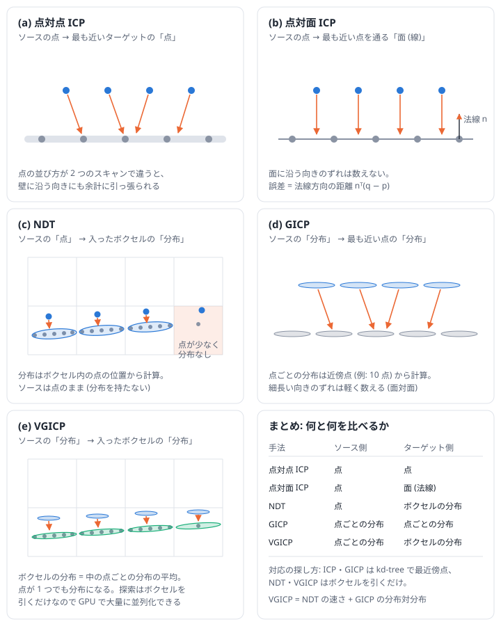
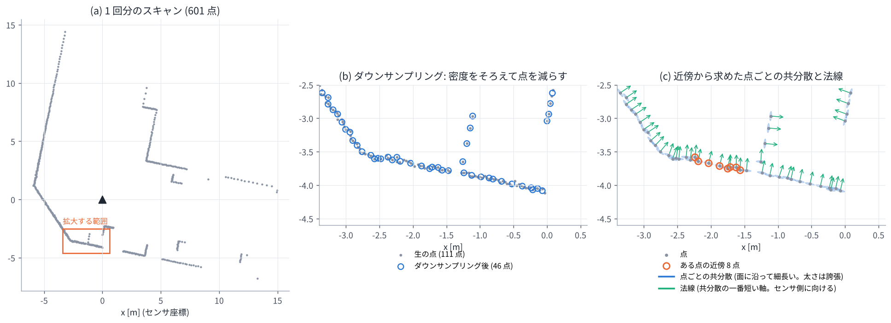
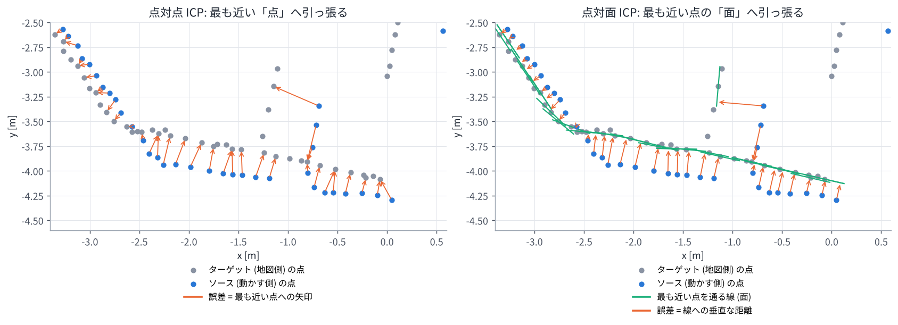
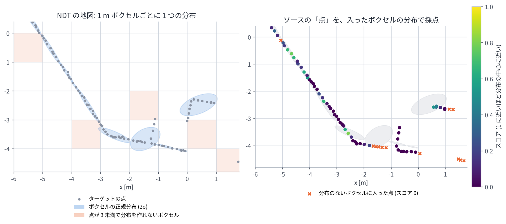
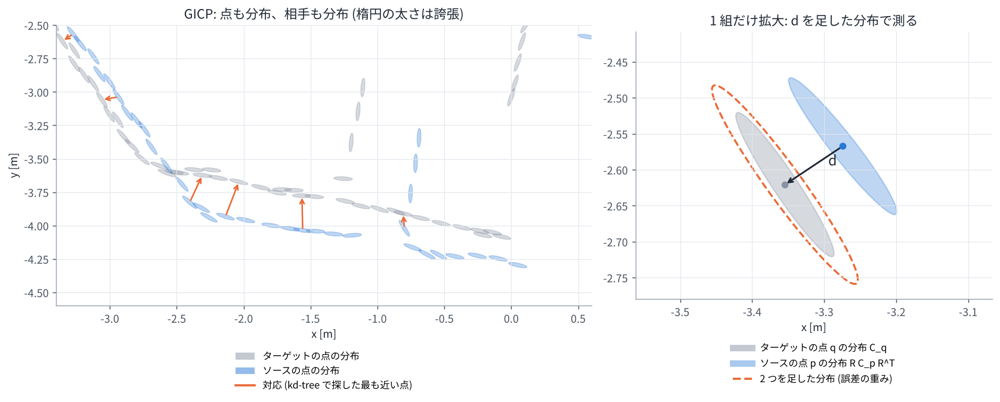
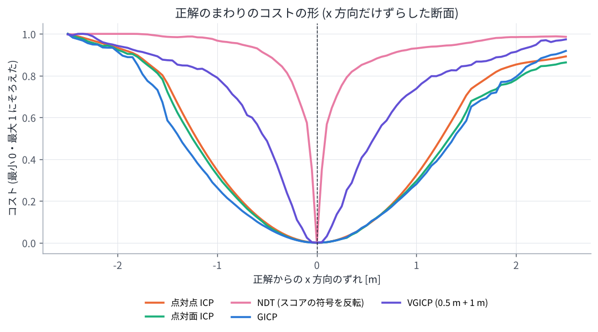
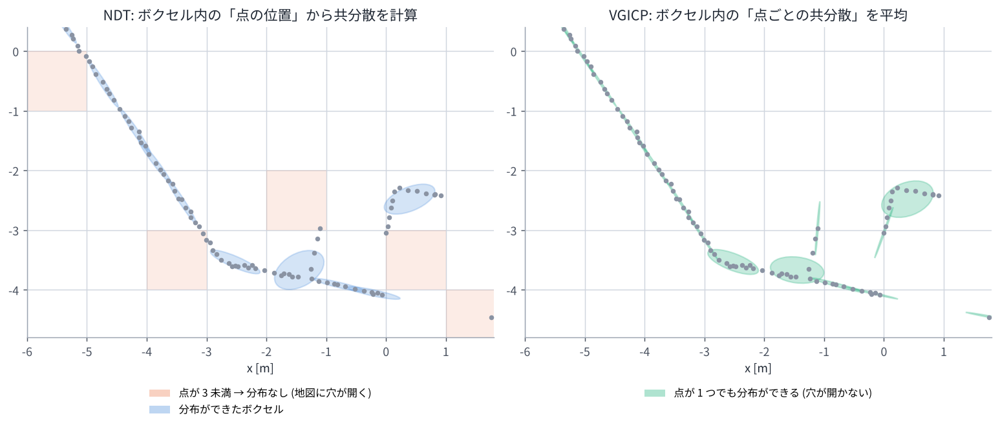
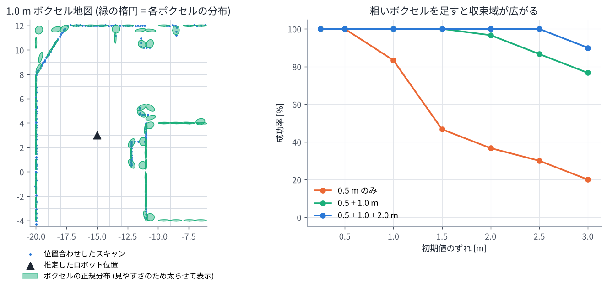
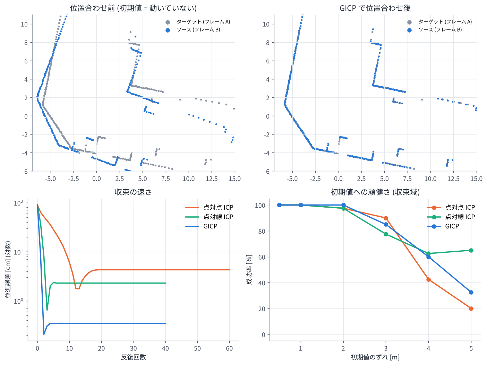

# 03. スキャンマッチング (ICP・NDT・GICP・VGICP)

## この章のゴール

- スキャンマッチング (点群の位置合わせ) が何をする処理か、なぜ繰り返し計算になるのかが分かる
- 点群の前処理 (ダウンサンプリング、近傍探索、点ごとの共分散と法線) が分かる
- 点対点 ICP・点対面 ICP・NDT・GICP・VGICP を、それぞれ図で説明できる
- **NDT と GICP の違い** を、「地図の表し方」「ソース側の扱い」「対応の探し方」「コストの形」の 4 点で説明できる
- VGICP が「NDT の速さ」と「GICP の精度」をどう両立しているかが分かる
- 論文が「位置合わせの結果」ではなく「位置合わせのコストそのもの」を因子にしている意味が分かる

> **論文とのつながり**
> 論文の $f^P(\mathbf{x}_i, \mathbf{x}_j)$ (フレーム同士) と $f^P(\mathbf{x}_i, \mathcal{M})$ (フレームと地図) は、
> どちらも **VGICP** のコストです。VGICP は著者自身が提案した手法で、NDT と GICP の考え方を組み合わせたものです。
> 比較手法の hdl_localization は NDT を使っています。この章で両方の違いが分かると、論文の比較実験の意味も見えてきます。

この章の図は、演習 3a (`exercises/ex03a_matching_methods.py`) で実際の 2D スキャンから作っています。
すべて同じ場面 (部屋の角と柱の付近) なので、手法ごとの違いを見比べてください。

---

## 1. スキャンマッチングとは

### 1.1 LiDAR の点群

LiDAR はレーザーを周囲に打ち、物体に当たって戻ってくるまでの時間から距離を測ります。
「どの向きに打ったら、何 m 先に当たったか」を座標に直したものが **点群** です。
点の座標は **センサ座標系** (LiDAR から見た座標) で表されています。

点群は物体の表面を **まばらにサンプリングしたもの** です。同じ壁でも、センサの位置が少し違えば、レーザーが当たる場所は違います。
また、センサから遠いほど隣のビームとの間隔が広がるので、点はまばらになります。

### 1.2 2 つの点群を重ねる問題

ロボットが少し動いて、2 回スキャンしたとします。2 つの点群は同じ壁を見ているのに、センサ座標系が違うのでずれて見えます。

- **ターゲット**: 動かさない側の点群。前のフレームや、事前に作った地図
- **ソース**: 動かす側の点群。新しく取ったスキャン

ソースを回転・平行移動 ($\mathbf{T}$) して、ターゲットにぴったり重なる $\mathbf{T}$ を探すのが **スキャンマッチング** (位置合わせ, registration) です。
重ねるのに必要な $\mathbf{T}$ が、2 つのスキャンの間にロボットがどれだけ動いたか (相対姿勢、[01 章](01_coordinates_and_rotation.md)) になります。

### 1.3 なぜ繰り返し計算になるのか

「ソースのこの点は、ターゲットのあの点と同じ場所」という **対応** が分かっていれば、
[02 章](02_probability_and_least_squares.md) の最小二乗で $\mathbf{T}$ が求まります。
しかし対応は分かりません。そして対応を正しく決めるには、だいたい正しい $\mathbf{T}$ が必要です。
「卵が先か鶏が先か」の状態なので、次の手順を繰り返します。

1. 今の推定値 $\mathbf{T}$ でソースの点を動かす
2. それぞれの点の **対応** を (近いものを) 探す
3. 対応が正しいと仮定して、**誤差** が小さくなるように $\mathbf{T}$ を更新する (ガウス・ニュートン法など)
4. $\mathbf{T}$ がほとんど変わらなくなったら終わり。そうでなければ 1 へ

この骨組みはどの手法でも同じです。手法の違いは、次の 3 つの選び方にあります。

| 選ぶもの | 選択肢の例 |
| --- | --- |
| ターゲット (地図) を何で表すか | 点のまま / 点と面の向き / ボクセルごとの正規分布 / 点ごとの正規分布 |
| 対応をどう探すか | 最も近い点を探す (kd-tree) / 点が入ったボクセルを引く |
| 誤差をどう測るか | 点と点の距離 / 面までの距離 / 分布の中でのありえなさ (マハラノビス距離) |



---

## 2. 前処理

どの手法でも、マッチングの前に点群を整えます。



### 2.1 ダウンサンプリング

1 回のスキャンには数万〜数十万点あるので、そのままでは計算が重すぎます。
空間を小さな立方体 (ボクセル、例えば 0.1〜0.25 m) に区切り、各ボクセルの点を 1 点 (重心) にまとめます。
センサの近くの密な部分が減り、点の密度がそろうという効果もあります (図の b)。

### 2.2 近傍探索と kd-tree

「ある点の近くにある点」を探す処理は、この後何度も出てきます。全部の点との距離を毎回計算すると遅いので、
**kd-tree** というデータ構造を使います。空間を x で半分、y で半分、… と交互に分けた木を作っておくと、
近い点を探すときに遠い枝を丸ごと飛ばせるので、点の数が多くても速く探せます。

### 2.3 点ごとの共分散と法線

ある点の近くの点 (例えば 10〜20 点) を集めて共分散行列を計算すると、その点の周りの **面の形** が分かります
([02 章](02_probability_and_least_squares.md) 3.3 節)。

- 壁の上の点なら、壁に沿う向きには大きく、壁に垂直な向きには小さい「平たい楕円」(3D では平たい楕円体) になる
- 一番短い軸の向き (最小固有値の固有ベクトル) が **法線** (面に垂直な向き)。符号は不定なので、センサの方を向くようにそろえる

図の c で、青い細長い楕円が点ごとの共分散、緑の矢印が法線です。この「点ごとの共分散」が GICP と VGICP の主役になります。

> 1 回のスキャンの間にもロボットは動くので、スキャンの最初と最後で座標がずれます。
> IMU を使ってこれを直す **歪み補正 (deskew)** もよく行われます ([04 章](04_imu_and_preintegration.md))。

---

## 3. 点対点 ICP

最も素朴な方法です (ICP = Iterative Closest Point)。ソースの各点を、ターゲットの **最も近い点** に近づけます。

```math
E(\mathbf{T}) = \sum_k \lVert \mathbf{q}_k - \mathbf{T}\mathbf{p}_k \rVert^2
```

$\mathbf{p}_k$ はソースの点、$\mathbf{q}_k$ はそれに最も近いターゲットの点です。
対応が決まっていれば、2 つの点群の重心を合わせてから特異値分解 (SVD) を使うと、最適な回転と並進が一発で求まります
(演習 3b の `icp_point_to_point`)。



**弱点**: 1.1 節の通り、2 つのスキャンでは壁の上の **同じ場所** に点があるとは限りません。
左の図のように、最も近い点は少し横にずれた場所にあることが多く、矢印が斜めを向きます。
そのため壁に沿う向きにも余計な力がかかり、**収束が遅く、ずれた位置で止まりやすく** なります。

## 4. 点対面 ICP

最も近い点そのものではなく、その点を通る **面** (2D では線) までの距離を測ります。法線を $\mathbf{n}_k$ とすると

```math
E(\mathbf{T}) = \sum_k \left(\mathbf{n}_k^\top(\mathbf{q}_k - \mathbf{T}\mathbf{p}_k)\right)^2
```

$\mathbf{n}_k^\top(\cdots)$ は、ずれのうち法線方向の成分だけを取り出す計算です。
右の図のように矢印が面に垂直になり、**面に沿う向きのずれは誤差に数えません**。
サンプリング位置の違いに強く、点対点 ICP よりずっと速く収束します (演習 3b では 3 回の反復で 1 cm 程度まで合います)。

---

## 5. NDT (Normal Distributions Transform)

### 5.1 考え方: 地図をボクセルごとの正規分布に要約する

NDT は、ターゲットを点のまま使うのをやめて、**格子状のボクセル (例えば 1 m 角) ごとに 1 つの正規分布** で表します。

1. ターゲットの空間をボクセルに区切る
2. 各ボクセルについて、中に入った **点の位置** から平均 $\boldsymbol{\mu}$ と共分散 $\boldsymbol{\Sigma}$ を計算する

```math
\boldsymbol{\mu} = \frac{1}{N}\sum_{i=1}^{N} \mathbf{q}_i,
\qquad
\boldsymbol{\Sigma} = \frac{1}{N}\sum_{i=1}^{N} (\mathbf{q}_i - \boldsymbol{\mu})(\mathbf{q}_i - \boldsymbol{\mu})^\top
```

ボクセルの中に壁の一部が通っていれば、壁に沿って細長い楕円になります。
こうして、地図は「点の集まり」から「楕円の集まり」になります。



### 5.2 マッチング: ソースの「点」を、入ったボクセルの分布で採点する

ソースの点 $\mathbf{p}_k$ を $\mathbf{T}$ で動かし、**入ったボクセル** の分布で「どれくらいありそうか」を計算します。

```math
\text{スコア}_k = \exp\!\left(-\frac{1}{2}\,(\mathbf{T}\mathbf{p}_k - \boldsymbol{\mu})^\top \boldsymbol{\Sigma}^{-1} (\mathbf{T}\mathbf{p}_k - \boldsymbol{\mu})\right)
```

これは正規分布の山の高さ (頂上を 1 とした値) で、分布の中心に近いほど 1、外れるほど 0 に近づきます
(右の図の色)。全部の点のスコアの合計が最大になる $\mathbf{T}$ を探します。
実際の実装 (PCL など) では、外れ値の影響を調整する定数を加えた式を、ニュートン法で最大化しています。

### 5.3 NDT の特徴

- **対応探索が速い**: 点の座標からボクセルの番号を計算するだけで、最近傍点を探す必要がない
- **外れ値に強い**: 1 点あたりのスコアは最大でも 1 なので、地図と合わない点 (人や車) がコストを大きく乱さない
- **点が少ないボクセルでは分布を作れない**: 共分散を計算するには数点以上が必要です (3D の PCL の実装では既定で 6 点)。
  図のオレンジのボクセルのように、点がまばらな所 (センサから遠い所など) では地図に **穴** が開く
- **ボクセルの大きさに敏感**: 小さすぎると穴だらけ、大きすぎると壁の角や細かい形がぼやける。
  角を含むボクセルは、2 つの壁の点を 1 つの分布にまとめるので丸っこくなる
- **ボクセルの境目で不連続**: 点が隣のボクセルに移ると、使う分布が急に切り替わる。
  隣のボクセルも見る (`ndt_omp` の DIRECT7 など)、格子を半分ずらしたものを重ねる、などの工夫がある
- 平らな壁の点だけからなるボクセルは、共分散が「厚み 0」に近くなり逆行列が計算できないので、
  小さすぎる固有値を持ち上げる補正を入れる

---

## 6. GICP (Generalized ICP)

### 6.1 考え方: 点ごとに「面の向き」を持たせ、分布と分布を比べる

GICP はボクセルを使いません。2.3 節の **点ごとの共分散** を、ターゲットの点にも **ソースの点にも** 持たせます。
つまり、どちらの点群も「小さな平たい楕円の集まり」として扱い、楕円と楕円を合わせます。



1. 各点の共分散を近傍点から計算する (ターゲット: $\mathbf{C}^{Q}_k$、ソース: $\mathbf{C}^{P}_k$)
2. ソースの点を $\mathbf{T}$ で動かし、kd-tree で **最も近いターゲットの点** を対応にする (ICP と同じ)
3. 対応のずれ $\mathbf{d}_k = \mathbf{q}_k - \mathbf{T}\mathbf{p}_k$ を、2 つの分布を足した共分散で重み付けして測る

```math
E(\mathbf{T}) = \sum_k \mathbf{d}_k^\top \left(\mathbf{C}^{Q}_k + \mathbf{R}\,\mathbf{C}^{P}_k\,\mathbf{R}^\top\right)^{-1} \mathbf{d}_k
```

### 6.2 なぜ 2 つの共分散を足すのか

ターゲットの点の位置にも、ソースの点の位置にも「面に沿ってどこにあってもおかしくない」という不確かさがあります。
2 つの不確かな位置の **差** の不確かさは、それぞれの共分散の **和** になります
(独立なばらつきは足し合わさる。ソースの共分散は $\mathbf{R}$ で回してターゲットの座標系に合わせる)。

右の図のオレンジの点線が、2 つを足した分布です。ずれ $\mathbf{d}$ はこの分布で測られるので、

- 楕円の長い向き (面に沿う向き) のずれは小さく数える
- 楕円の短い向き (面に垂直な向き) のずれは大きく数える

ことになります。演習 3a の例では、長さ 0.096 m のずれが、面に垂直な成分のために誤差 1.94 (σ 何個分かの 2 乗) と数えられています。
両方の点群の面の向きを使うので「**面対面**」のマッチングと呼ばれます。

### 6.3 共分散の正規化と、ICP との関係

GICP では、近傍から求めた共分散の固有値を **(1, 1, ε)** (2D では (1, ε)、ε は 0.001 程度) に置き換えます。
点の分布の「大きさ」は捨てて、「面の向き」だけを残す操作です。

この共分散の選び方次第で、GICP は ICP の仲間になります。

- すべての共分散を単位行列にすると → 重みがどの向きも同じになり、**点対点 ICP**
- ソース側を 0、ターゲット側を「法線方向だけ小さい」形にすると → **点対面 ICP**

GICP は ICP を一般化 (generalize) したもの、というのが名前の由来です。
コストは普通の重み付き最小二乗なので、[02 章](02_probability_and_least_squares.md) のガウス・ニュートン法で解けます。

---

## 7. NDT と GICP の違い

どちらも「正規分布」を使うので似て見えますが、使い方がまったく違います。

### 7.1 ひとことで言うと

- **NDT**: 地図を **ボクセルごとの分布に要約** しておき、ソースの **点** を当てはめる
- **GICP**: 地図もソースも **点ごとに面の向き (分布)** を持たせ、**面と面** を合わせる

### 7.2 4 つの違い

| | NDT | GICP |
| --- | --- | --- |
| ① 地図 (ターゲット) の表し方 | ボクセルごとに 1 つの分布 | 点ごとに 1 つの分布 |
| 分布の作り方 | ボクセル内の点の位置から計算 | 近くの点 (10〜20 点) から計算し、形を (1, 1, ε) に正規化 |
| ② ソース側の扱い | 点のまま (分布なし) | 点ごとの分布 |
| ③ 対応の探し方 | 点が入ったボクセルを引く (速い) | kd-tree で最も近い点を探す (遅め) |
| ④ コスト | スコア exp(−½ マハラノビス距離²) の和を最大化。1 点あたり上限 1 | マハラノビス距離² の和を最小化 (最小二乗) |
| 得意なこと | 速い。外れ値の影響を受けにくい | 精度が高い。ボクセルの大きさに左右されない |
| 苦手なこと | 点がまばらだと穴が開く。ボクセルの大きさに敏感。境目で不連続 | 最近傍探索が重い。外れ値は対応距離の上限などで別に対策が必要 |

**① 分布の単位**: NDT は「ボクセルという決まった枠」で点を区切ってから分布を作るので、
枠の中に点が少なければ分布ができず、枠の中に角があれば丸っこい分布になります。
GICP は点ごとに近くの点から分布を作るので、枠に縛られず、角でもそれぞれの壁の向きを保てます。
下のデモで、ボクセルの大きさや格子の位置を動かすと、NDT の分布がどう変わるかを確かめられます。

<!-- demo:voxel -->

**② ソース側**: NDT はソースを点として扱う「点対分布」、GICP は「分布対分布」です。
GICP はソース側の面の向きも使うので、2 つのスキャンで点の取れ方が違っても安定します。

**③ 対応の探し方**: NDT は「点の座標 ÷ ボクセルの大きさ」でボクセルの番号が決まり、表を 1 回引くだけです。
GICP は kd-tree をたどって最も近い点を探します。点が多いと、この差が速度の差になります。
ただし、NDT は **入ったボクセルしか見ない** ので、遠くにある正解の壁には引き寄せられません。
GICP は対応距離の上限 (例えば 1〜2 m) までなら、少し離れた点にも対応を作れます。

**④ コストの形**: 下の図は、正解の位置からソースを x 方向にずらしたとき、各手法のコストがどう変わるかを描いたものです (演習 3a)。



- GICP や ICP のコストは、ずれとともになだらかに増える **広い谷** になっています。最近傍探索で少し離れた点にも対応が付くからです
- NDT のスコアは、正解付近だけが深い **狭い谷** で、少しずれると平らになります。
  入ったボクセルの分布しか見ないことと、1 点あたりのスコアに上限があることが理由です
- 谷が狭いと、初期値が少しずれただけで正しい答えに向かう手がかりがなくなります。
  実際の NDT では、隣のボクセルも見る、粗いボクセルから細かいボクセルへ段階的に合わせる、などの工夫で谷を広げます

> この図は、この教材の単純な実装で作った 1 方向の断面です。実際のライブラリの性能比較ではありません。
> 傾向をつかむための図として見てください。

---

## 8. VGICP: NDT の速さと GICP の精度を両立する

VGICP (Voxelized GICP) は、論文の著者が提案した手法で、論文のすべてのマッチング因子に使われています。

### 8.1 考え方

- 地図は **NDT のようにボクセル** で区切る → 対応探索は表を 1 回引くだけで速い
- ただしボクセルの分布は、点の位置からではなく、**中の点ごとの共分散 (GICP と同じもの) を平均** して作る
- ソース側も **GICP のように点ごとの分布** を持ち、コストは **GICP と同じ最小二乗**

```math
\boldsymbol{\mu}^{\text{voxel}} = \frac{1}{N}\sum_{i=1}^{N} \mathbf{q}_i,
\qquad
\mathbf{C}^{\text{voxel}} = \frac{1}{N}\sum_{i=1}^{N} \mathbf{C}^{Q}_i
```

```math
\begin{aligned}
E(\mathbf{T}) &= \sum_k \mathbf{d}_k^\top \left(\mathbf{C}^{\text{voxel}}_k + \mathbf{R}\,\mathbf{C}^{P}_k\,\mathbf{R}^\top\right)^{-1}\mathbf{d}_k \\
\mathbf{d}_k &= \boldsymbol{\mu}^{\text{voxel}}_k - \mathbf{T}\mathbf{p}_k
\end{aligned}
```

$\boldsymbol{\mu}^{\text{voxel}}_k$, $\mathbf{C}^{\text{voxel}}_k$ は、動かしたソースの点 $\mathbf{T}\mathbf{p}_k$ が入ったボクセルの平均と共分散です。

### 8.2 NDT との違い: 同じボクセルでも分布の作り方が違う



点ごとの共分散は、ボクセルの枠に関係なく近くの点から計算済みです。そのため **点が 1 つしかないボクセルでも、その点の分布がそのままボクセルの分布になり**、NDT のような穴が開きません
(演習 3a では、NDT は 68 個中 46 個のボクセルでしか分布を作れず、VGICP は 68 個すべてで作れています)。
一方、角を含むボクセルが丸っこくなるのは NDT と同じです。ボクセルの大きさは NDT ほど大きくせず、
GLIM では 0.25〜0.5 m 程度を基本にしています。

### 8.3 GPU と相性が良い理由

VGICP の計算は、ソースの全点について「ボクセルを引く → 2×2 (3D では 3×3) の行列計算をする」を同じように繰り返すだけです。

- kd-tree のように、点ごとに木をたどる回数が違う (処理の分岐が多い) ことがない
- 全点が同じ手順なので、GPU の数千のコアに 1 点ずつ割り当てて並列に計算できる

これが、論文で多数のマッチング因子をリアルタイムに計算できている理由です。

### 8.4 マルチ解像度ボクセル

VGICP は入ったボクセル 1 つとしか比べないので、7.2 節の NDT と同じく、そのままでは谷が狭くなります。
そこで、細かいボクセルと粗いボクセルを **両方** 使ってコストを足し合わせます (GLIM の設定 `voxelmap_levels`)。
粗いボクセルが遠くからの手がかりになり、細かいボクセルが精度を出します。演習 4 で、粗いボクセルを足すと収束域 (うまく合う初期値の範囲) が広がることを確認できます。



さらに論文の手法では、**IMU で予測した姿勢** を初期値にするので、もともと正解に近い所から始められます ([04 章](04_imu_and_preintegration.md))。

---

## 9. 手法を動かして比べる

演習 3b では、点対点 ICP・点対面 ICP・GICP を実際に反復させて、収束の速さと初期値への強さを比べます。



- 収束の速さ (左下): 点対面 ICP と GICP は 2〜3 回の反復でほぼ収束、点対点 ICP は数十回かかり、少しずれた位置で止まる
- 初期値への強さ (右下): 初期値のずれが 2 m 程度までは、どの手法もほぼ成功する。それ以上ずれると失敗が増える

<!-- demo:icp -->

---

## 10. 位置合わせの「結果」ではなく「コスト」を因子にする

ここが論文 (と著者の一連の研究) を理解するうえで重要な点です。

**よくある方法 (疎結合・ポーズグラフ)**:
ICP などで 2 フレーム間の相対姿勢を求め、その結果 (と、だいたいの共分散) を「相対姿勢の観測」としてグラフに入れます。

**論文の方法 (マッチングコスト因子)**:
VGICP の誤差関数 $E(\mathbf{T}_i^{-1}\mathbf{T}_j)$ そのものを因子 $f^P(\mathbf{x}_i, \mathbf{x}_j)$ としてグラフに入れます。
最適化のたびに、今の推定値で対応を取り直して線形化します (GLIM の `IntegratedVGICPFactorGPU`)。

この違いには次の意味があります。

- 位置合わせの結果を 1 つの正規分布で要約するときの **情報の欠落がない**
- 廊下のような退化した環境でも、「決まる方向」の情報だけが自然にグラフに入り、
  決まらない方向は IMU など他の因子が補う
- 1 つのフレームを複数のフレーム・地図と **同時に** 合わせられる

GLIM の論文では、因子 1 つあたりの線形化結果 ($\mathbf{H}$ と $\mathbf{b}$ のブロック) を、全点の和として GPU で計算しています。

```math
\begin{aligned}
\mathbf{H}_{ii} &= \sum_k \mathbf{A}_k^\top \boldsymbol{\Omega}_k \mathbf{A}_k \\
\mathbf{H}_{ij} &= \sum_k \mathbf{A}_k^\top \boldsymbol{\Omega}_k \mathbf{B}_k \\
\mathbf{H}_{jj} &= \sum_k \mathbf{B}_k^\top \boldsymbol{\Omega}_k \mathbf{B}_k
\end{aligned}
```

($\mathbf{A}_k$, $\mathbf{B}_k$ は 2 つの姿勢に対する誤差のヤコビアン、$\boldsymbol{\Omega}_k$ は 8.1 節の重み (共分散の和の逆行列)。転置の位置は論文によって書き方が異なります)
演習 7 の `ScanFactor.linearize` が、これを numpy で書いたものです。

## 11. GPU のちょっとした話

GLIM の論文によれば、多数の VGICP 因子を線形化するとき、

- 線形化点 (各姿勢の推定値) をまとめて 1 回で GPU に送り、
- 因子ごとの計算は複数のストリームで並列に行い、
- 結果もまとめて 1 回で CPU に戻す

ことで、因子の数によらず CPU⇔GPU の転送を 2 回に抑えています。
「計算そのもの」より「転送や同期」がボトルネックになりやすいのが GPU プログラミングの勘所です。

---

## 演習 3a, 3b, 4

```bash
python exercises/ex03a_matching_methods.py   # この章の図: 前処理・ICP・NDT・GICP・VGICP・コストの形
python exercises/ex03b_icp_2d.py             # 点対点 ICP・点対面 ICP・GICP を反復させて比較
python exercises/ex04_vgicp_2d.py            # VGICP のボクセル地図、対応探索の速さ、マルチ解像度
```

## 理解度チェック

1. スキャンマッチングが繰り返し計算になるのはなぜ?
2. 点対点 ICP が LiDAR の点群で偏りやすいのはなぜ?
3. NDT のボクセルの分布は何から作る? 点の少ないボクセルではどうなる?
4. GICP の $(\mathbf{C}^{Q}_k + \mathbf{R}\mathbf{C}^{P}_k\mathbf{R}^\top)^{-1}$ は何を表している? なぜ 2 つの共分散を足す?
5. NDT と GICP の違いを、地図の表し方・ソース側の扱い・対応の探し方・コストの形の 4 点で説明せよ。
6. NDT の谷が狭くなりやすいのはなぜ? どんな対策がある?
7. VGICP は NDT と GICP のどこを受け継いでいる?
8. 「位置合わせの結果を因子にする」のと「位置合わせのコストを因子にする」のでは何が違う?

<details markdown="1">
<summary>答えの例</summary>

1. 対応 (どの点とどの点が同じ場所か) が分からず、対応を正しく決めるにはだいたい正しい $\mathbf{T}$ が必要だから。「対応を決める → $\mathbf{T}$ を更新する」を交互に繰り返す。
2. 2 つのスキャンで表面上の同じ位置の点が取れているとは限らず、最も近い点が少し横にずれた場所にあるため、面に沿う向きにも余計な誤差が生じる。
3. ボクセル内の点の位置から平均と共分散を計算する。点が少ない (数点未満の) ボクセルでは分布を作れず、地図に穴が開く。
4. ソースの点の分布とターゲットの点の分布の差の共分散の逆、つまり情報行列。2 つの不確かな位置の差の不確かさは、それぞれの共分散の和になるから。面の法線方向の誤差を重く、面に沿う方向を軽く数える。
5. 地図: NDT はボクセルごとの分布、GICP は点ごとの分布。ソース: NDT は点、GICP は分布。対応: NDT はボクセルを引く、GICP は kd-tree で最近傍点を探す。コスト: NDT はスコア (上限 1) の和の最大化、GICP はマハラノビス距離の 2 乗和の最小化。
6. 入ったボクセルの分布しか見ず、1 点あたりのスコアに上限があるので、正解から離れると手がかりがなくなるから。隣のボクセルも見る、粗いボクセルから段階的に合わせる、格子をずらして重ねる、良い初期値 (IMU など) を使う、などで対策する。
7. NDT から: ボクセルで地図を区切り、対応を表引きで決める (速い、GPU 向き)。GICP から: 点ごとの共分散 (ボクセルの分布はその平均)、ソース側も分布、最小二乗のコスト。
8. 結果を因子にすると、相対姿勢の正規分布という要約で情報が失われる。コストを因子にすると、点ごとの誤差を最適化のたびに線形化し直すので、退化方向の扱いや複数フレームとの同時マッチングが自然にできる。

</details>

## もっと知りたい人へ

- P. J. Besl, N. D. McKay, "A Method for Registration of 3-D Shapes," IEEE TPAMI, 1992. (ICP)
- P. Biber, W. Straßer, "The Normal Distributions Transform: A New Approach to Laser Scan Matching," IROS 2003. (2D の NDT)
- M. Magnusson, "The Three-Dimensional Normal-Distributions Transform," 博士論文, Örebro University, 2009. (3D の NDT。PCL の実装のもと)
- A. Segal, D. Haehnel, S. Thrun, "Generalized-ICP," RSS 2009.
- K. Koide, M. Yokozuka, S. Oishi, A. Banno, "Voxelized GICP for Fast and Accurate 3D Point Cloud Registration," ICRA 2021.
- K. Koide et al., "Globally Consistent 3D LiDAR Mapping with GPU-accelerated GICP Matching Cost Factors," IEEE RA-L, 2021.
- 著者の実装: [fast_gicp](https://github.com/koide3/fast_gicp), [small_gicp](https://github.com/koide3/small_gicp), [gtsam_points](https://github.com/koide3/gtsam_points), [ndt_omp](https://github.com/koide3/ndt_omp) (高速な NDT)

---

前へ: [02 確率と最小二乗](02_probability_and_least_squares.md) ｜ 次へ: [04 IMU と事前積分](04_imu_and_preintegration.md)
