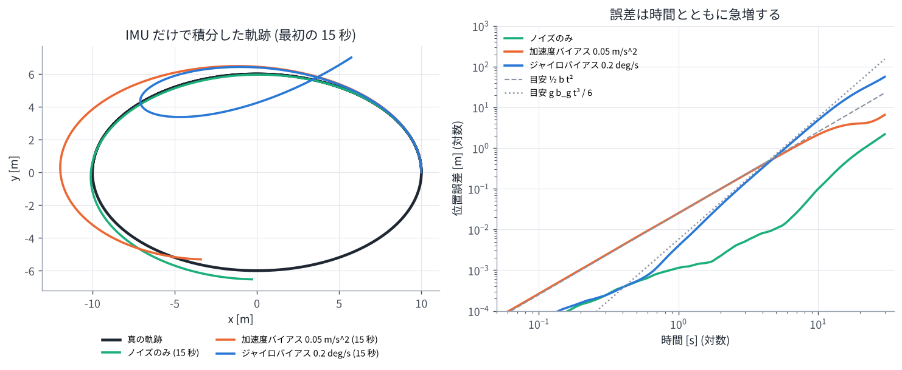
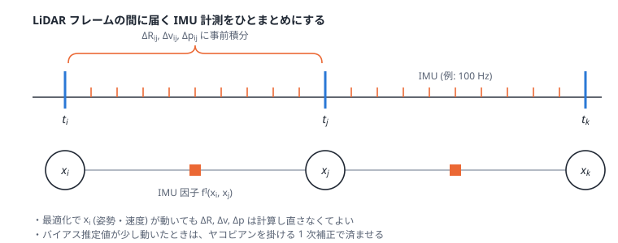

# 04. IMU と事前積分 (preintegration)

## この章のゴール

- IMU が何を測っているか (角速度と「比力」) を式で書ける
- バイアスとノイズがあると、IMU だけの積分はすぐにずれていく (ドリフトする) ことが分かる
- IMU 事前積分 $\Delta\mathbf{R}, \Delta\mathbf{v}, \Delta\mathbf{p}$ とは何か、なぜ効率的なのかを説明できる
- IMU 因子 $f^I(\mathbf{x}_{i-1}, \mathbf{x}_i)$ の誤差の形が分かる

> **論文とのつながり**
> 論文の $f^I(\mathbf{x}_{i-1}, \mathbf{x}_i)$ は Forster らの IMU 事前積分 [Forster+ RSS2015] に基づく因子です。
> 論文本文では「線形化のたびに再積分する必要がないため誤差計算が効率的」と説明されています。
> この章では、その「再積分しなくてよい」理由を理解します。

---

## 1. IMU が測るもの

IMU (Inertial Measurement Unit, 慣性計測装置) は主に 2 種類のセンサを持ちます。

- **ジャイロスコープ**: センサ座標系での角速度 $\boldsymbol{\omega}$ [rad/s]
- **加速度計**: センサ座標系での **比力 (specific force)** [m/s²]

注意が必要なのは加速度計で、測っているのは「加速度」ではなく **加速度から重力加速度を引いたもの** です。

```math
\tilde{\boldsymbol{\omega}} = \boldsymbol{\omega} + \mathbf{b}^{\omega} + \boldsymbol{\eta}^{\omega},
\qquad
\tilde{\mathbf{a}} = \mathbf{R}^\top(\mathbf{a}^{\text{world}} - \mathbf{g}) + \mathbf{b}^{a} + \boldsymbol{\eta}^{a}
```

- $\mathbf{g} = (0, 0, -9.81)$ (z 軸上向きの世界座標)
- $\mathbf{b}^{\omega}, \mathbf{b}^{a}$: **バイアス** (ゆっくり変化するオフセット)
- $\boldsymbol{\eta}^{\omega}, \boldsymbol{\eta}^{a}$: ホワイトノイズ

止まっている IMU の加速度計は、重力に逆らって支えられている分の **上向き +9.81 m/s²** を出力します。
「止まっているのに 9.81 が出る」のは故障ではありません。GLIM の設定の説明にも、
「IMU を静止させて z 軸を上に向けたとき、加速度が +9.81 付近になるか確認する」とあります。

> **実用上の注意**: Livox などの内蔵 IMU は加速度を [g] 単位で出すことがあり、その場合は 9.80665 倍が必要です
> (GLIM の `acc_scale`)。また LiDAR と IMU の相対姿勢 (外部パラメータ `T_lidar_imu`) と時刻同期が
> ずれていると、どんな手法でも精度が出ません。

## 2. IMU だけで積分すると (デッドレコニング)

IMU の値を積分すれば姿勢・速度・位置が求まります。時間刻み $\Delta t$ で離散化すると:

```math
\begin{aligned}
\mathbf{R}_{k+1} &= \mathbf{R}_k \operatorname{Exp}\!\left((\tilde{\boldsymbol{\omega}}_k - \mathbf{b}^{\omega})\Delta t\right) \\
\mathbf{v}_{k+1} &= \mathbf{v}_k + \mathbf{g}\Delta t + \mathbf{R}_k(\tilde{\mathbf{a}}_k - \mathbf{b}^{a})\Delta t \\
\mathbf{p}_{k+1} &= \mathbf{p}_k + \mathbf{v}_k\Delta t + \tfrac{1}{2}\mathbf{g}\Delta t^2 + \tfrac{1}{2}\mathbf{R}_k(\tilde{\mathbf{a}}_k - \mathbf{b}^{a})\Delta t^2
\end{aligned}
```

しかし、加速度は 2 回積分して位置になるので、少しの誤差でも急速に膨らみます。

- 加速度バイアス $b$ が残っていると、位置誤差はおよそ $\frac{1}{2} b t^2$
- ジャイロバイアス $b_g$ が残っていると、傾きの誤差 $b_g t$ のせいで重力 $g$ が横向きに漏れ込み、
  位置誤差はおよそ $\frac{1}{6} g\, b_g\, t^3$



演習 5 では、0.2 deg/s という小さなジャイロバイアスでも、10 秒で約 5 m ずれることが分かります。

<!-- demo:imu -->

> **HTML 版**: ここでバイアスの大きさをスライダーで変えて、軌跡がどうずれるかを見られます。

### それでも IMU が役に立つ理由

IMU は **短い時間** なら非常に正確で、しかも 100〜1000 Hz と高頻度です。

- LiDAR フレーム間 (0.1 秒) の動きの予測 → スキャンマッチングの良い初期値 ([02 章](02_probability_and_least_squares.md))
- 1 スキャン中の動きによる点群の歪みの補正 (deskew)
- 長い廊下など、点群だけでは決まらない方向 (退化) を補う
- 激しい動きでも追従できる

逆に、ゆっくり溜まるドリフトは LiDAR (と地図) で抑えます。**お互いの弱点を補い合う**のが LiDAR-IMU 融合です。
そのために、**バイアスも状態に含めて一緒に推定**します。

```math
\mathbf{x}_i = [\mathbf{T}_i,\ \mathbf{v}_i,\ \mathbf{b}_i], \qquad \mathbf{b}_i = [\mathbf{b}^a_i,\ \mathbf{b}^{\omega}_i] \in \mathbb{R}^6
```

## 3. 素朴な方法の問題: 状態が変わるたびに積分し直し

最適化では、$\mathbf{x}_i$ の推定値が反復のたびに変わります。上の積分式は始点の $\mathbf{R}_i, \mathbf{v}_i, \mathbf{p}_i$ から
出発するので、素朴にやると **$\mathbf{x}_i$ が変わるたびに、区間内の数十〜数百個の IMU 計測を積分し直す** ことになります。
ウィンドウ内に数十フレームあり、毎回数回反復するとなると、これはかなりの無駄です。

## 4. 事前積分: 始点に依存しない量だけを先に積分しておく

積分式を変形して、**始点の状態に依存しない部分だけ**を先にまとめておくのが事前積分です。
区間 $[t_i, t_j]$ について、

```math
\begin{aligned}
\Delta\mathbf{R}_{ij} &= \prod_{k=i}^{j-1} \operatorname{Exp}\!\left((\tilde{\boldsymbol{\omega}}_k - \mathbf{b}^{\omega}_i)\Delta t\right) \\
\Delta\mathbf{v}_{ij} &= \sum_{k=i}^{j-1} \Delta\mathbf{R}_{ik}(\tilde{\mathbf{a}}_k - \mathbf{b}^{a}_i)\Delta t \\
\Delta\mathbf{p}_{ij} &= \sum_{k=i}^{j-1} \left[\Delta\mathbf{v}_{ik}\Delta t + \tfrac{1}{2}\Delta\mathbf{R}_{ik}(\tilde{\mathbf{a}}_k - \mathbf{b}^{a}_i)\Delta t^2\right]
\end{aligned}
```

と定義します。これらは **IMU の計測値とバイアスだけ** で決まり、$\mathbf{R}_i, \mathbf{v}_i, \mathbf{p}_i$ を含みません。
すると、終点の状態は始点の状態から次のように「一発で」予測できます ($\Delta t_{ij} = t_j - t_i$)。

```math
\begin{aligned}
\mathbf{R}_j &= \mathbf{R}_i\,\Delta\mathbf{R}_{ij} \\
\mathbf{v}_j &= \mathbf{v}_i + \mathbf{g}\Delta t_{ij} + \mathbf{R}_i\Delta\mathbf{v}_{ij} \\
\mathbf{p}_j &= \mathbf{p}_i + \mathbf{v}_i\Delta t_{ij} + \tfrac{1}{2}\mathbf{g}\Delta t_{ij}^2 + \mathbf{R}_i\Delta\mathbf{p}_{ij}
\end{aligned}
```



### IMU 因子の誤差

IMU 因子 $f^I(\mathbf{x}_i, \mathbf{x}_j)$ は、「推定値どうしから計算した相対運動」と「事前積分値」のずれです。

```math
\begin{aligned}
\mathbf{r}_{\Delta R} &= \operatorname{Log}\!\left(\Delta\mathbf{R}_{ij}^\top\,\mathbf{R}_i^\top\mathbf{R}_j\right) \\
\mathbf{r}_{\Delta v} &= \mathbf{R}_i^\top(\mathbf{v}_j - \mathbf{v}_i - \mathbf{g}\Delta t_{ij}) - \Delta\mathbf{v}_{ij} \\
\mathbf{r}_{\Delta p} &= \mathbf{R}_i^\top(\mathbf{p}_j - \mathbf{p}_i - \mathbf{v}_i\Delta t_{ij} - \tfrac{1}{2}\mathbf{g}\Delta t_{ij}^2) - \Delta\mathbf{p}_{ij}
\end{aligned}
```

この 9 次元の誤差を、事前積分の間に伝播させたノイズの共分散で重み付けした 2 乗誤差が $f^I$ です。
最適化中に $\mathbf{x}_i, \mathbf{x}_j$ が変わっても、変わるのはこの式の中の $\mathbf{R}_i, \mathbf{v}_i, \ldots$ だけで、
$\Delta\mathbf{R}_{ij}, \Delta\mathbf{v}_{ij}, \Delta\mathbf{p}_{ij}$ はそのまま使えます。

### バイアスが変わったら? → 1 次補正

事前積分値はバイアス $\mathbf{b}_i$ に依存します。最適化でバイアスの推定値が $\delta\mathbf{b}$ だけ変わったら、
本当は積分し直しが必要ですが、変化が小さければ **ヤコビアンを使った 1 次近似** で済ませます。

```math
\Delta\mathbf{v}_{ij}(\mathbf{b} + \delta\mathbf{b}) \approx \Delta\mathbf{v}_{ij}(\mathbf{b})
+ \frac{\partial \Delta\mathbf{v}_{ij}}{\partial \mathbf{b}^a}\delta\mathbf{b}^a
+ \frac{\partial \Delta\mathbf{v}_{ij}}{\partial \mathbf{b}^\omega}\delta\mathbf{b}^\omega
```

($\Delta\mathbf{R}, \Delta\mathbf{p}$ も同様。ヤコビアンは事前積分と同時に漸化式で計算しておけます)
演習 5 では、この 1 次補正が積分し直しとほぼ一致することを確かめます。

### バイアスの変化のモデル

バイアスは「ゆっくりランダムに変化する」(ランダムウォーク) とモデル化し、隣り合う状態のバイアスをつなぐ因子
$\lVert\mathbf{b}_j - \mathbf{b}_i\rVert^2_{\boldsymbol{\Sigma}_b}$ も入れます。
GLIM のコードでは `BetweenFactor<imuBias::ConstantBias>` として IMU 因子と一緒に追加されています。

## 5. GTSAM での IMU 因子

GTSAM には事前積分と IMU 因子が実装されています。Python 版ではおおよそ次のように使います
(発展演習 `exercises/optional/opt_gtsam_imu_isam2.py`)。

```python
params = gtsam.PreintegrationParams.MakeSharedU(9.81)      # z 上向き, 重力 9.81
pim = gtsam.PreintegratedImuMeasurements(params, bias)
for acc, gyro in imu_between_frames:
    pim.integrateMeasurement(acc, gyro, dt)                 # 事前積分
graph.add(gtsam.ImuFactor(X(i), V(i), X(j), V(j), B(i), pim))  # IMU 因子
```

GLIM のコードでも同じ `gtsam::ImuFactor` が使われています ([09 章](09_author_code_guide.md))。

## 6. 初期化: 重力の向きを知る

IMU の積分を始めるには、最初の姿勢 (特に重力に対する傾き) と速度・バイアスの初期値が必要です。
静止していれば加速度計の向きが重力の向きになりますが、動きながら始める場合は工夫が要ります。
GLIM には `initialization_mode` として、数秒間のデータから頑健に推定する方式などが用意されています。
自己位置推定 (論文) では、さらに **地図上の初期位置** も必要です ([07 章](07_map_based_localization.md))。

## 演習 5

```bash
python exercises/ex05_imu.py
```

- IMU だけの積分で、ノイズ・加速度バイアス・ジャイロバイアスがどれだけドリフトを生むか
- 事前積分値を再利用すると、始点の状態を変えても積分し直しと完全に一致すること
- バイアスが変わったときの 1 次補正の精度

## 理解度チェック

1. 静止した IMU の加速度計が 0 ではなく約 9.81 m/s² を出力するのはなぜ?
2. ジャイロバイアスによる位置誤差が時間の 3 乗で増えるのはなぜ?
3. 事前積分 $\Delta\mathbf{R}_{ij}, \Delta\mathbf{v}_{ij}, \Delta\mathbf{p}_{ij}$ が始点の状態に依存しないことで、何がうれしい?
4. バイアスを状態に含めて推定する理由は?

<details markdown="1">
<summary>答えの例</summary>

1. 加速度計は「加速度 − 重力加速度」(比力) を測る。静止時は加速度 0 なので、−g = 上向き 9.81 が出る。
2. バイアスで姿勢の傾き誤差が $b_g t$ と時間に比例して増え、それによって重力 $g$ の一部 ($g\,b_g t$) が水平方向の加速度誤差になる。これを 2 回積分すると $t^3$ に比例する。
3. 最適化で状態が何度変わっても、IMU 計測の積分をやり直さずに済む (残差の計算が速い)。
4. バイアスは機体・温度・時間で変わり事前に正確には分からないが、残っていると積分誤差が急増する。LiDAR の情報と一緒に推定すれば、オンラインで補正できる。

</details>

## もっと知りたい人へ

- C. Forster, L. Carlone, F. Dellaert, D. Scaramuzza, "IMU Preintegration on Manifold for Efficient Visual-Inertial Maximum-a-Posteriori Estimation," RSS 2015. (同タイトルの拡張版が IEEE T-RO 2017)
- T. Lupton, S. Sukkarieh, "Visual-Inertial-Aided Navigation for High-Dynamic Motion in Built Environments Without Initial Conditions," IEEE T-RO 2012. (事前積分の元祖)

---

前へ: [03 スキャンマッチング](03_point_cloud_registration.md) ｜ 次へ: [05 ファクターグラフ](05_factor_graph.md)
