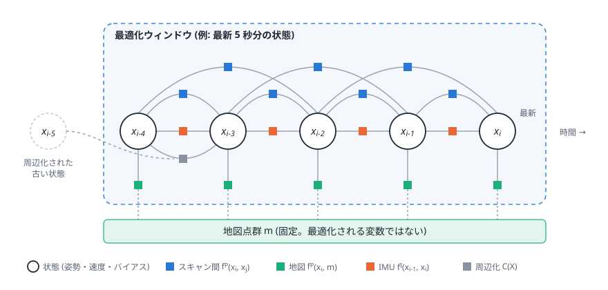
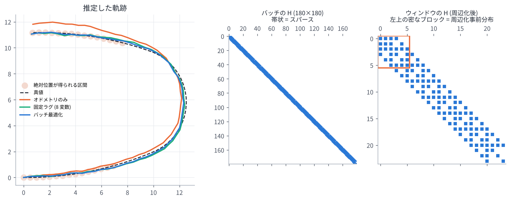

# 05. ファクターグラフ (GTSAM と iSAM2)

## この章のゴール

- ファクターグラフ (変数と因子のグラフ) で推定問題を表せる
- 因子が「関係する変数のところだけ」に情報を足すので、問題が **スパース (疎)** になることが分かる
- GTSAM の基本的な使い方 (グラフ・初期値・最適化) のイメージを持つ
- iSAM2 が「新しい因子が来るたびに、必要な部分だけ計算し直す」手法であることが分かる

> **論文とのつながり**
> 論文の手法は GTSAM で実装され、最適化には iSAM2 を使っています。
> 論文のコスト関数 $F(\mathcal{X})$ は、そのまま 1 つのファクターグラフとして描けます (下図)。

---

## 1. ファクターグラフとは

推定したい量を **変数 (variable)** 、変数どうしの関係を表す確率的な制約を **因子 (factor)** として、
両者をつないだグラフです。

- 変数: 各時刻の状態 $\mathbf{x}_i$ (姿勢・速度・バイアス)
- 因子: センサ観測などから決まる「この変数たちはこういう関係にあるはず」という制約。
  1 つ 1 つが $\lVert\text{誤差}\rVert^2_{\boldsymbol{\Sigma}}$ の項になる

すべての因子の積が事後確率に比例し、その最大化は ([02 章](02_probability_and_least_squares.md) の通り)
すべての因子の 2 乗誤差の和の最小化になります。

```math
\hat{\mathcal{X}} = \arg\min_{\mathcal{X}} \sum_{\text{因子 } k} \lVert \mathbf{e}_k(\mathcal{X}_k) \rVert^2_{\boldsymbol{\Sigma}_k}
\qquad (\mathcal{X}_k: \text{因子 } k \text{ に関係する変数だけ})
```

論文の式を描くと次のようになります。



| 因子 | つながる変数 | 色 |
| --- | --- | --- |
| スキャン間マッチング f^P(x_i, x_j) | 2 つ (最新とその 1〜2 個前) | 青 |
| 地図マッチング f^P(x_i, M) | 1 つ (地図は固定なので変数ではない) | 緑 |
| IMU 事前積分 f^I(x_{i-1}, x_i) | 2 つ (連続する状態) | オレンジ |
| 周辺化 C(X) | ウィンドウの古い端の数個 | 灰色 |

1 つの変数だけにつながる因子を **単項因子 (unary factor)**、
2 つにつながる因子を **二項因子 (binary factor)** と呼びます。地図マッチング因子は単項因子です。

## 2. スパース性: 因子は関係する変数にしか効かない

ガウス・ニュートン法の $\mathbf{H} = \sum_k \mathbf{J}_k^\top\mathbf{J}_k$ を考えます。
因子 $k$ のヤコビアン $\mathbf{J}_k$ は、関係する変数の列だけが非ゼロです。
したがって $\mathbf{J}_k^\top\mathbf{J}_k$ も、関係する変数どうしのブロックだけが非ゼロになります。

- 単項因子 → 対角ブロック 1 つ
- 二項因子 $(i, j)$ → ブロック $(i,i), (i,j), (j,i), (j,j)$

時系列のグラフでは、近い時刻どうしにしか因子がないので、$\mathbf{H}$ は **帯状のスパース行列** になります。



(中央の図: 60 個の姿勢を一括最適化したときの $\mathbf{H}$。非ゼロ要素は全体の約 3%)

スパースな行列は、専用の分解 (スパースなコレスキー分解など) で非常に速く解けます。
変数の並べ方 (消去順序) によって分解中に生まれる非ゼロ要素 (fill-in) の量が変わるので、
GTSAM は COLAMD などで良い順序を自動的に選びます。

## 3. GTSAM の基本

GTSAM (Georgia Tech Smoothing and Mapping) は、ファクターグラフで推定問題を解く C++ ライブラリです
(Python ラッパーもあります)。基本の流れは次の 3 ステップです。

```python
import gtsam
from gtsam.symbol_shorthand import X, V, B   # 変数の名前 (キー): X(3) = 3 番目の姿勢 など

graph = gtsam.NonlinearFactorGraph()           # 1. 因子を並べる
graph.add(gtsam.PriorFactorPose3(X(0), pose0, noise))            # 単項因子
graph.add(gtsam.BetweenFactorPose3(X(0), X(1), rel_pose, noise))  # 二項因子
graph.add(gtsam.ImuFactor(X(0), V(0), X(1), V(1), B(0), pim))     # IMU 因子 (5 変数)

initial = gtsam.Values()                       # 2. 変数の初期値を入れる
initial.insert(X(0), pose0_guess)
...

result = gtsam.LevenbergMarquardtOptimizer(graph, initial).optimize()  # 3. 最適化
```

自作の因子は、「誤差 $\mathbf{e}$ とヤコビアン (または線形化した $\mathbf{H}, \mathbf{b}$) を返すクラス」を
作ればグラフに入れられます。著者の **gtsam_points** は、VGICP などのスキャンマッチングのコストを
GTSAM の因子として実装したライブラリです (`IntegratedVGICPFactorGPU` など)。
[09 章](09_author_code_guide.md) で詳しく見ます。

## 4. iSAM2: 増えていくグラフを効率よく解く

ロボットは動き続けるので、グラフには新しい変数と因子が次々に追加されます。
毎回ゼロから全体を解き直すのは無駄です。

**iSAM2** [Kaess+ IJRR2012] は、

1. 問題を「ベイズ木 (Bayes tree)」というデータ構造の形で分解したまま保持し、
2. 新しい因子が来たら、その影響を受ける部分 (たいてい木の上の方の、新しい変数の周り) だけを分解し直し、
3. 線形化点からのずれが大きくなった変数だけを再線形化する

ことで、毎回の更新を高速にしています。GLIM の設定にある `isam2_relinearize_thresh` (再線形化するかどうかの閾値) や
`isam2_relinearize_skip` (何回に 1 回再線形化をチェックするか) は、この 3. を調整するパラメータです。

> 細かいアルゴリズム (ベイズ木の作り方など) は、この論文を理解するうえでは
> 「必要なところだけ計算し直してくれる高速なソルバ」という理解で十分です。

## 5. バッチ・フィルタ・スムーザ

| 方式 | 何を最適化するか | 長所 | 短所 |
| --- | --- | --- | --- |
| バッチ最適化 | 最初から今までの全状態 | 最も正確 | 時間とともに計算量が増える |
| フィルタ (カルマンフィルタ等) | 最新の状態だけ (過去はすぐ周辺化) | 軽い | 一度線形化した過去の情報は修正できない |
| 固定ラグ平滑化 (論文) | 最新の数秒分の状態 | 計算量一定で、ウィンドウ内は何度でも再線形化できる | ウィンドウの外は固定される |

論文の手法は 3 番目です。次の章で詳しく見ます。

## 演習 6 (前半)

```bash
python exercises/ex06_factor_graph.py
```

- numpy だけでファクターグラフ (姿勢の事前分布・オドメトリ・絶対位置観測) を組み立てて解く
- $\mathbf{H}$ のスパース性を可視化する
- 後半の固定ラグ平滑化は [06 章](06_fixed_lag_smoothing.md) で扱う

GTSAM をインストールできる人は、`exercises/optional/opt_gtsam_imu_isam2.py` で
本物の `ImuFactor` と iSAM2 を試してみてください。

## 理解度チェック

1. 変数 $\mathbf{x}_3$ と $\mathbf{x}_5$ をつなぐ二項因子は、$\mathbf{H}$ のどのブロックに値を足す?
2. 地図マッチング因子 $f^P(\mathbf{x}_i, \mathcal{M})$ が単項因子なのはなぜ?
3. iSAM2 が毎回全体を解き直すより速いのはなぜ?

<details markdown="1">
<summary>答えの例</summary>

1. $(3,3), (3,5), (5,3), (5,5)$ のブロック。
2. 地図点群 $\mathcal{M}$ は既知で固定 (最適化しない) なので、変数は $\mathbf{x}_i$ の 1 つだけだから。
3. 分解の結果 (ベイズ木) を保持しておき、新しい因子の影響を受ける部分だけを計算し直すから。再線形化も必要な変数だけに絞っている。

</details>

## もっと知りたい人へ

- F. Dellaert, M. Kaess, "Factor Graphs for Robot Perception," Foundations and Trends in Robotics, 2017.
- M. Kaess et al., "iSAM2: Incremental Smoothing and Mapping Using the Bayes Tree," IJRR 2012.
- GTSAM 公式: <https://gtsam.org/> (チュートリアルと Python の例が充実)

---

前へ: [04 IMU と事前積分](04_imu_and_preintegration.md) ｜ 次へ: [06 固定ラグ平滑化と周辺化](06_fixed_lag_smoothing.md)
