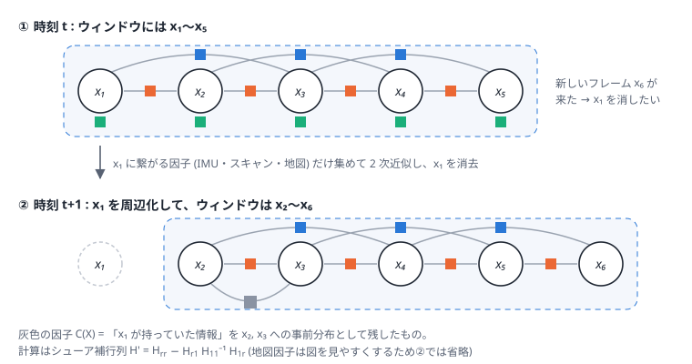

# 06. 固定ラグ平滑化と周辺化 (ウィンドウ最適化)

## この章のゴール

- 「最新の数秒分の状態だけを最適化する」固定ラグ平滑化の流れを説明できる
- ウィンドウから外れる状態を **周辺化** して、その情報を残す方法 (シューア補行列) が分かる
- 周辺化せずにただ捨てると何が起こるかを体験する
- 疎結合と密結合の違い、キーフレームの役割が分かる

> **論文とのつながり**
> 論文の $\mathcal{X}$ は「最適化ウィンドウ内の状態 (例: 5 秒分)」、$C(\mathcal{X})$ は
> 「ウィンドウ外に出た変数・因子を補償する周辺化因子」です。
> 論文の手法は、著者の先行研究 [Koide+ ICRA2022] の **固定ラグ平滑化による LiDAR-IMU オドメトリ** をベースに、
> 地図とのマッチング因子を追加したものです。

---

## 1. 疎結合と密結合

LiDAR と IMU を組み合わせる方法は大きく 2 つあります。

- **疎結合 (loosely coupled)**: LiDAR だけでスキャンマッチングして姿勢を求め、その「結果」を IMU とフィルタで融合する。
  シンプルだが、LiDAR だけでは決まらない状況 (廊下など) でマッチング結果自体が崩れると立て直せない
- **密結合 (tightly coupled)**: 点群のマッチングコストと IMU の制約を **1 つの最適化問題** に入れて同時に解く。
  互いの弱点を最適化の中で補い合える

論文の手法は密結合です。[03 章](03_point_cloud_registration.md) の「コストそのものを因子にする」考え方が、密結合を自然に実現しています。

## 2. 固定ラグ平滑化の流れ

固定ラグ平滑化 (fixed-lag smoothing) は、**最新の L 秒分の状態だけ** を変数として持ち、まとめて最適化します。
新しい LiDAR フレームが来るたびに次を繰り返します。

1. **予測**: 直前の状態から IMU 事前積分で新しい状態 $\mathbf{x}_i$ を予測する (最適化の初期値になる)
2. **因子の追加**: IMU 因子・バイアス因子、直前フレームとのスキャンマッチング因子、地図マッチング因子を追加
3. **最適化**: ウィンドウ内の全状態を最適化 (論文では iSAM2)
4. **周辺化**: L 秒より古い状態をウィンドウから外し、その情報を周辺化因子 $C(\mathcal{X})$ に移す

GLIM の設定 `smoother_lag` (既定値 5.0 秒) がこの L です。論文の「例: ウィンドウ長 5 秒」と一致します。

### ウィンドウ最適化のうれしさ

- 過去数秒の状態も **新しい情報で修正される** (フィルタは過去を修正できない)
- ウィンドウ内では何度でも **再線形化** できるので、非線形性に強い
- 計算量はウィンドウの大きさで決まり、走行時間が延びても増えない
- 一瞬だけ点群が使えない (センサの前を人が横切った、退化した) フレームがあっても、前後の数秒の情報で支えられる

## 3. 周辺化: 消す変数の情報を残す

ウィンドウから古い状態 $\mathbf{x}_m$ を消すとき、$\mathbf{x}_m$ に繋がっていた因子をただ捨てると、
その因子が持っていた情報 (例えば「地図で確かめた位置」) も消えてしまいます。

**周辺化 (marginalization)** は、$\mathbf{x}_m$ について「積分して消す」操作で、
ガウス分布 (2 次近似) の世界では **シューア補行列** で計算できます。

$\mathbf{x}_m$ に繋がる因子だけを集めて線形化し、変数を「消すもの $m$」と「残すもの $r$」に分けると

```math
\begin{bmatrix} \mathbf{H}_{mm} & \mathbf{H}_{mr} \\ \mathbf{H}_{rm} & \mathbf{H}_{rr} \end{bmatrix}
\begin{bmatrix} \boldsymbol{\delta}_m \\ \boldsymbol{\delta}_r \end{bmatrix}
= -\begin{bmatrix} \mathbf{b}_m \\ \mathbf{b}_r \end{bmatrix}
```

から $\boldsymbol{\delta}_m$ を消去して、

```math
\mathbf{H}' = \mathbf{H}_{rr} - \mathbf{H}_{rm}\mathbf{H}_{mm}^{-1}\mathbf{H}_{mr},
\qquad
\mathbf{b}' = \mathbf{b}_r - \mathbf{H}_{rm}\mathbf{H}_{mm}^{-1}\mathbf{b}_m
```

が得られます。$(\mathbf{H}', \mathbf{b}')$ を持つ 2 次の項 (線形化された事前分布) を、残った変数に対する新しい因子として
グラフに加えます。これが $C(\mathcal{X})$ です。



### 注意点

- **密になる**: $\mathbf{x}_m$ に繋がっていた変数どうしが、新しい因子で全部つながる (fill-in)。
  演習 6 の右の図で、ウィンドウの $\mathbf{H}$ の左上に密なブロックができているのがそれです
- **線形化点が固定される**: 周辺化因子はそのときの推定値で線形化した 2 次式なので、後で推定値が大きく動くと近似が悪くなる。
  理論的にはこれが推定の「一貫性」を損ねることがあり、研究テーマにもなっています (FEJ など)
- **確信が強すぎると修正が遅れる**: 周辺化因子が強い (情報が多い) と、ウィンドウの古い側の状態がなかなか動かなくなる。
  演習 7 では、地図のない区間からある区間に戻ったとき、ドリフトの修正がウィンドウ長 (3 秒) くらい遅れて効く様子が見られる

GTSAM には固定ラグ平滑化と周辺化を iSAM2 と組み合わせて行う `IncrementalFixedLagSmoother` があります
(バージョンによっては `gtsam_unstable` 側にあります)。著者の gtsam_points はそれを拡張した
`IncrementalFixedLagSmootherExt` を持ち、GLIM のオドメトリでは最適化に失敗したときの立て直し機能を加えた
`IncrementalFixedLagSmootherExtWithFallback` が使われています。

### 周辺化せずに捨てると?

演習 6 で `USE_MARGINALIZATION = False` にすると、地図 (絶対位置の観測) がない区間で
ウィンドウの位置を決める手がかりがなくなり、誤差が約 7 倍 (0.17 m → 1.2 m) になります。
周辺化が「過去の情報」をウィンドウに受け継いでいることが分かります。

## 4. スキャン間マッチングをどのフレームと取るか: キーフレーム

論文の式では、最新の状態 $\mathbf{x}_i$ は **直前の 2 フレーム** ($j = i-2, i-1$) とマッチングします。
GLIM の設定 `full_connection_window_size` (設定ファイルの値は 2) がこれに対応します。

さらに GLIM のオドメトリでは、**キーフレーム** (重なりの度合いなどで選んだ代表フレーム) ともマッチングします。

- キーフレームがウィンドウ内にあれば二項因子 $f^P(\mathbf{x}_{\text{key}}, \mathbf{x}_i)$
- キーフレームがウィンドウから出ていたら、その姿勢を固定した単項因子

これにより、連続するフレームどうしの誤差が積み重なってドリフトするのを抑えています
(論文本文ではキーフレームについては触れられていませんが、ベースになっている GLIM のオドメトリはこの仕組みを持っています)。

> **気づき**: 「ウィンドウから出たキーフレームを固定した単項因子」は、構造としては
> 「位置が固定された点群 (地図) とのマッチング因子」と同じです。論文の地図マッチング因子は、
> この「固定された点群」を **事前に作った地図** にしたものと見ることもできます。

## 5. ウィンドウ長のトレードオフ

| 長くすると | 短くすると |
| --- | --- |
| 精度・頑健性が上がる (多くの情報で支え合う) | 計算が軽い |
| 地図のない区間などを長く支えられる | 急な修正が速く効く |
| 計算が重くなる | 一時的な劣化に弱くなる |

## 6. 2D 再現実験で確かめる

演習 7 では、この章の内容をすべて組み込んだ 2D 版の推定器を動かします
(スライディングウィンドウ、IMU 事前積分、VGICP 因子、周辺化)。
結果の詳しい見方は [08 章](08_paper_walkthrough.md) で扱います。

```bash
python exercises/ex06_factor_graph.py                  # 固定ラグと周辺化の基本
python exercises/ex07_sliding_window_localization.py   # 論文の手法の 2D 版 (1〜3 分)
```

## 理解度チェック

1. 固定ラグ平滑化で、新しい状態の初期値には何を使う? なぜ?
2. シューア補行列 $\mathbf{H}_{rr} - \mathbf{H}_{rm}\mathbf{H}_{mm}^{-1}\mathbf{H}_{mr}$ は何を表している?
3. 周辺化因子が密になるのはなぜ?
4. フィルタと比べて、固定ラグ平滑化が非線形性に強いのはなぜ?

<details markdown="1">
<summary>答えの例</summary>

1. IMU 事前積分で前の状態から予測した値。短時間の IMU 予測は正確なので、スキャンマッチング (非線形最小二乗) の良い初期値になる。
2. 消した変数 $\mathbf{x}_m$ を積分 (周辺化) した後に、残った変数に残る情報行列。$\mathbf{x}_m$ を介して伝わっていた制約が、残った変数どうしの直接の制約になったもの。
3. $\mathbf{x}_m$ を介してつながっていた変数どうしが、$\mathbf{x}_m$ を消したことで直接つながるため。
4. フィルタは一度線形化して取り込んだ情報を後で線形化し直せないが、平滑化はウィンドウ内の因子を推定値が更新されるたびに再線形化できるから。

</details>

## もっと知りたい人へ

- K. Koide, M. Yokozuka, S. Oishi, A. Banno, "Globally Consistent and Tightly Coupled 3D LiDAR Inertial Mapping," ICRA 2022. (論文のベースになっているオドメトリ)
- K. Koide et al., "GLIM: 3D Range-Inertial Localization and Mapping with GPU-Accelerated Scan Matching Factors," Robotics and Autonomous Systems, 2024. (arXiv:2407.10344)
- G. Sibley, L. Matthies, G. Sukhatme, "Sliding Window Filter with Application to Planetary Landing," JFR 2010.

---

前へ: [05 ファクターグラフ](05_factor_graph.md) ｜ 次へ: [07 既知地図上の自己位置推定](07_map_based_localization.md)
