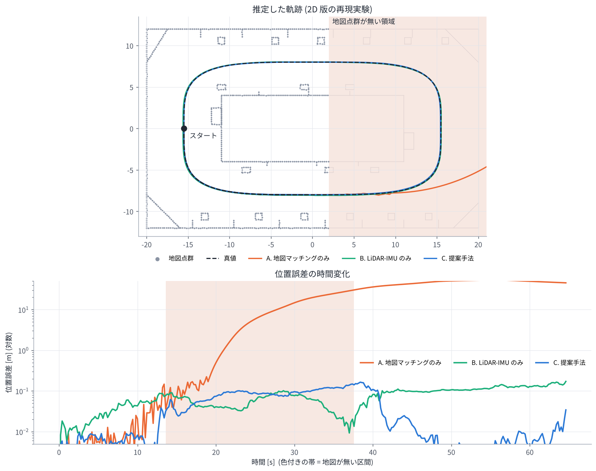

# 07. 既知地図上の自己位置推定 (従来手法と提案手法の違い)

## この章のゴール

- 「SLAM」「オドメトリ」「既知地図上の自己位置推定」の違いが分かる
- 論文の比較手法 (NDT マッチング、UKF ベースの hdl_localization、パーティクルフィルタベースの mcl3d_ros) の仕組みと、
  地図が欠けた領域で失敗しやすい理由を説明できる
- 提案手法が地図の欠損に強い理由を、ファクターグラフの言葉で説明できる

> **論文とのつながり**
> 論文の実験では、地図点群の大部分 (点線で囲んだ領域以外) を削除し、
> 既存手法が地図の欠損した領域に入ると推定が破綻する一方で、提案手法は推定を続けられ、
> 地図のある領域に戻るとドリフトが抑えられた、と報告されています。

---

## 1. 3 つの問題設定

| 問題 | 地図 | 推定するもの | 例 |
| --- | --- | --- | --- |
| オドメトリ | 使わない | 出発点からの相対的な動き (誤差は溜まる) | LiDAR-IMU オドメトリ, FAST-LIO2 |
| SLAM | 走りながら作る | 地図と軌跡の両方 (ループ閉じ込みで誤差を修正) | GLIM, hdl_graph_slam, LIO-SAM |
| 既知地図上の自己位置推定 | 事前に作ったものを使う | 地図の座標系での自分の姿勢 | NDT localization, hdl_localization, **この論文** |

自己位置推定は、自動運転や配送ロボットなど「同じ場所を何度も走る」用途で使われます。
地図は SLAM であらかじめ作っておき、本番ではその地図の上で「今どこにいるか」を求めます。

> **前提**: 自己位置推定を始めるには、地図上の **初期位置** がだいたい分かっている必要があります
> (手動で与える、GNSS を使う、全体探索 (global localization) を使うなど)。論文は初期位置が与えられたあとの
> 追跡 (tracking) を扱っています。

## 2. 従来手法の仕組み

### (a) 地図マッチングのみ (NDT スキャンマッチング)

毎フレーム、前フレームの姿勢 (+ 等速モデルなどによる予測) を初期値として、点群を地図に NDT で合わせます。

- 地図が十分にある場所では高精度
- **地図がない場所では、合わせる相手がいない** → 予測をそのまま使うしかなく、予測が外れるとそのまま破綻

### (b) カルマンフィルタ (UKF) + 地図マッチング: hdl_localization

著者の過去の公開ソフトウェア [hdl_localization](https://github.com/koide3/hdl_localization) は、

1. **予測**: IMU (なければ等速モデル) で状態を進める
2. **更新**: 点群を地図に NDT で合わせた結果 (姿勢) を観測として UKF で補正する

という構成です。IMU を使っていますが、

- 補正の情報源は **地図とのマッチングだけ**
- 地図がない区間では IMU だけの予測が続く → [04 章](04_imu_and_preintegration.md) のように急速にドリフト
- 疎結合なので、マッチングが崩れたときにそれを IMU で救うことは難しい

### (c) パーティクルフィルタ (MCL): mcl3d_ros

Akai による [mcl3d_ros](https://github.com/NaokiAkai/mcl3d_ros) は 3D LiDAR のモンテカルロ位置推定 (MCL) です。
多数の仮説 (パーティクル) を持ち、各パーティクルの位置で点群が地図 (距離場, distance field) にどれだけ合うかで重み付けします。
さらに、距離場を使った観測モデルの最適化結果を重点サンプリングで融合して、効率と精度を上げています。

- 複数の仮説を持てるので、多峰性 (似た場所が複数ある) や大きな誤差からの復帰に強い
- **重みの計算が地図に依存する** → 地図がない場所ではどのパーティクルも同じくらい「合わない」ため、
  正しい仮説を選べなくなる

### 共通する弱点

3 つとも、**「今どこにいるか」を確かめる手段が地図とのマッチングだけ** です。
地図が欠けている・地図作成時から環境が変わっている (工事、駐車車両、家具の移動など) と、
その間は推定を支えるものがなくなります。

## 3. 提案手法: 地図マッチングを「数ある因子の 1 つ」にする

提案手法では、地図マッチングは目的関数の 1 項にすぎません。

```math
F(\mathcal{X}) = \underbrace{\sum\sum f^{P}(\mathbf{x}_i, \mathbf{x}_j)}_{\text{フレーム同士}}
 + \underbrace{\sum f^{P}(\mathbf{x}_i, \mathcal{M})}_{\text{地図}}
 + \underbrace{\sum f^{I}(\mathbf{x}_{i-1}, \mathbf{x}_i)}_{\text{IMU}}
 + C(\mathcal{X})
```

| 状況 | 効いている因子 | 結果 |
| --- | --- | --- |
| 地図がある場所 | 地図 + フレーム同士 + IMU | 地図の座標系で高精度。IMU バイアスも推定される |
| 地図がない場所 | フレーム同士 + IMU (+ 過去の地図の情報が周辺化因子 C(X) に) | LiDAR-IMU オドメトリとして推定を継続。ゆっくりドリフト |
| 地図に戻った場所 | 再び地図も | 地図マッチングでドリフトが修正される |

地図マッチングの対応が見つからない点は、自然に因子に寄与しなくなります (VGICP は「点が入ったボクセルに地図の分布がある」
ときだけ誤差を数える)。つまり **地図がない場所では地図因子が自動的に弱くなり、他の因子が主役になる** のです。
これは何か特別な切り替え処理をしているわけではなく、すべてを 1 つの最適化問題に入れたことによる性質です。

## 4. 2D 再現実験の結果

演習 7 では、地図の右半分 (x > 2 m) を削除した 2D 環境で、3 つの手法を比べます。



| 手法 | 地図あり (前半) | 地図なし区間 | 地図に戻った後 |
| --- | --- | --- | --- |
| A. 地図マッチングのみ | 約 3 cm | 約 14 m (破綻) | 約 47 m (戻れない) |
| B. LiDAR-IMU のみ (地図なし) | 約 4 cm | 約 6 cm | 約 11 cm (ドリフトが残る) |
| C. 提案手法 | 約 1 cm | 約 9 cm | 約 5 cm (地図で修正) |

(位置誤差の RMSE。乱数の種は固定していますが、numpy のバージョンなどで数値は多少変わります。自分の実行結果も確認してください)

- A は地図のない区間に入ると、等速モデルの予測だけでは右端の U ターンを曲がりきれずに破綻し、二度と戻れません
- B と C は地図のない区間でも同程度の精度で推定を続けます (使える情報が同じ LiDAR + IMU なので)
- C は地図のある区間に戻ると、地図マッチングでドリフトを打ち消します

論文の実験 (実機の 3D LiDAR) とスケールは違いますが、同じ傾向が再現できます。

## 5. 考えておきたいこと (論文を批判的に読む)

- **初期位置**: 追跡を始めるための初期位置推定は別の問題として残る
- **地図が「間違っている」場合**: 地図が欠けているだけでなく、地図にある物体が動いていると、
  誤った対応が地図因子に入る。対応距離の上限やロバストカーネルがどれくらい効くか
- **地図とフレームの重み付け**: 地図因子とフレーム同士の因子の相対的な強さはどう決めるべきか
- **長時間の地図なし区間**: オドメトリのドリフトが大きくなると、地図に戻ったときの VGICP の収束域
  (マルチ解像度でどこまで広げられるか) を超えてしまう可能性
- **計算資源**: GPU が前提の設計。組込み機器 (Jetson など) での実行速度
- **定量評価**: 論文の評価は軌跡の図による定性的な比較が中心。ATE などの数値で比べるとどうなるか

こうした疑問を自分で立てられるようになると、論文の理解が一段深まります。

## 演習 7

```bash
python exercises/ex07_sliding_window_localization.py
```

`MAP_X_MAX` (地図の残す範囲) や `SMOOTHER_LAG` (ウィンドウ長) を変えて、結果がどう変わるか試してみてください。

## 理解度チェック

1. hdl_localization が IMU を使っているのに、地図がない区間で破綻しやすいのはなぜ?
2. パーティクルフィルタが地図のない場所で正しい仮説を選べなくなるのはなぜ?
3. 提案手法で、地図がない場所に入ったときに「切り替え処理」が要らないのはなぜ?

<details markdown="1">
<summary>答えの例</summary>

1. 補正 (更新) の情報源が地図とのマッチングだけで、地図がないと IMU だけの予測になり、IMU 単独の積分は数秒で大きくドリフトするから。フレーム同士のマッチングによる制約がない。
2. パーティクルの重みを「その位置で点群が地図に合う度合い」で計算するので、地図がないとどのパーティクルも同じ重みになり、区別できないから。
3. 地図との対応が取れない点は地図因子に寄与しなくなり、その分フレーム同士の因子と IMU 因子が推定を支える。すべてを 1 つの最適化問題に入れているので、効く因子の比重が自動的に変わる。

</details>

## もっと知りたい人へ

- K. Koide, J. Miura, E. Menegatti, "A Portable 3D LIDAR-based System for Long-term and Wide-area People Behavior Measurement," IJARS, 2019. (hdl_graph_slam / hdl_localization)
- N. Akai, "Efficient Solution to 3D-LiDAR-based Monte Carlo Localization with Fusion of Measurement Model Optimization via Importance Sampling," arXiv:2303.00216, 2023. (mcl3d_ros)
- P. Biber, W. Straßer, "The Normal Distributions Transform: A New Approach to Laser Scan Matching," IROS 2003.

---

前へ: [06 固定ラグ平滑化と周辺化](06_fixed_lag_smoothing.md) ｜ 次へ: [08 論文精読ガイド](08_paper_walkthrough.md)
